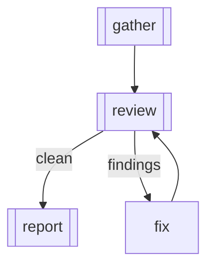

# Calling workflows, and child sessions

A workflow can call another workflow. The callee's work runs in a child
session of its own, which opens with what the caller's model had seen or
with nothing. A fresh model step and a judge's look are children too.
This document says how a call is written, what its contract is, how a
child is recorded and driven, and what crosses the boundary between a
caller and a child.

How runs are keyed and recorded is in
[record-and-replay.md](record-and-replay.md). What a judge is for is in
[questions-and-judges.md](questions-and-judges.md).

## Calling a workflow

A program node that names `flow` calls that workflow:

````markdown


## review
```yaml
flow: pr-review
with:
  pr: ${{ inputs.pr }}
  diff: ${{ steps.gather.outputs.diff }}
```
````

- `flow` takes the place of `run` and of `tool`/`args`. A node with
  `flow` has no `outputs`: its data is whatever the callee outputs.
- The shape is `[[ ]]`, because the program makes the call.
- `flow` names one of two things:
  - **another workflow skill**, by its name (`flow: pr-review`). The host
    finds it the way it finds any skill.
  - **a workflow file in the same skill**, by a path starting `./`
    (`flow: ./flows/triage.md`). The file has the format of a
    `WORKFLOW.md` and is taken from the snapshot the skill was loaded
    from, so the skill's digest covers it. Its workflow is named
    `<skill>/<path without .md>`, here `pr-review/flows/triage`. Its
    scripts are paths within the skill. It can be called only from within
    its skill: a skill's surface is its marked workflow.
- Loading a workflow loads every workflow it can reach. A missing or
  invalid one is a load error that names the chain of calls:
  `take-issue → review → pr-reviw: no such workflow`.
- Flows nest to any depth up to the depth bound
  ([limits-failure-and-intervention.md](limits-failure-and-intervention.md)).
  A workflow may call itself, directly or through others.
- When the callee ends, the caller goes on from the calling step, by the
  callee's outcome.

In Go a node sets `Flow`, and `Graph.Link(flows...)` resolves the calls
of a graph and of what it calls, and checks each contract. `Apply`
refuses a graph that calls and is not linked. Loading from skills is in
[workflow-format.md](workflow-format.md). A script of a workflow of
another skill than the run's root names its skill in `ScriptCall.Skill`,
and `script.Skills` gives each skill's files.

## The contract

A workflow's outcomes are its ends, and its outputs are declared by
outcome ([workflow-format.md](workflow-format.md),
[steps-and-data.md](steps-and-data.md)). A call is held to them at load:

| Part | The caller | Checked at load |
|---|---|---|
| inputs | `with` | every input the callee requires is given on every path into the call, and no name is unknown. An input with a default may be left out. A literal holds to its schema. A reference holds to the callee's schema on each path, using the schema the referenced outcome declares there |
| outcomes | the node's `outcomes`, which default to the callee's plus `failed` | the caller's list is the callee's set, with or without `failed`. An edge for any other outcome is an error |
| data | `steps.review.outputs.x` | `x` is an output of the outcome taken on each path that reaches the reference, the same rule as for a step's members. A loop that can call again with another outcome loses the first outcome's outputs |

An output's schema is the schema of what it refers to, where every
outcome of the referenced step that declares the member agrees, and
untyped otherwise. Whether a member is present is read path by path.

A value whose schema is not known until it is made, such as the untyped
output of a script, is checked again when the call is made. A value that
breaks the schema then fails the step.

### `failed` is an outcome of every call

A callee that fails gives the caller the outcome `failed`, with the data
`{reason, workflow}` and, where the callee's end names the step it failed
at, `step`. A call whose child ran past the call's timeout, or could not
be opened, gives `{reason, workflow}`.

- The caller routes on `failed` like any other outcome.
- With no edge for `failed`, the calling step fails instead and raises
  its retry question. An unrouted `failed` is therefore no way out of the
  calling workflow: it is not among that workflow's outcomes, and no
  outputs are asked for on it.
- A failure on a bound across the tree skips the `failed` edge: every
  run above fails with it.
- An end may be named `failed`. Reaching it ends the run `failed` with
  that outcome, and it declares no outputs.

## Context: what a child opens with

Every call to a workflow runs in a child session. The caller holds one
`flow_call` while the callee works, and is given its result. `context`
says what the child's model begins with:

- **`session`, the default for a call.** The child opens with the
  caller's view as it stood when the call was made: what the caller's
  model had been sent, without the call itself. The callee's `session`
  model steps read that and go on from it.
- **`fresh`.** The child opens with nothing. It sees the inputs its call
  passes in, the instructions its settings give it and its own tools.

Either way:

- **The child's record is its own.** What it opened with is no part of
  it: position, visit counts, references and documents are read from what
  the child's session wrote itself
  ([record-and-replay.md](record-and-replay.md)).
- **The caller gets back the call's result and nothing else:** the
  callee's outcome and outputs, what `show` lets a model see of them, and
  the documents the call hands back. The callee's turns never enter the
  caller's conversation, so what a later step of the caller needs from
  them is an output.
- **What the child opened with is shown as the caller's model saw it.**
  What no working model may read is left out there too.
- **It works at any depth.** A child that calls opens a child of its own,
  which opens with the first child's view, its inherited part included.

A model step's `context` says where the step works, not what a child
opens with: `session` is its run's session, and `fresh` is a child of its
own that opens with nothing ([steps-and-data.md](steps-and-data.md)).

Four things can make work fresh:

| Who says | How |
|---|---|
| the call | `context: fresh` on the calling node |
| the model step | `context: fresh` on the step |
| another model | a model step whose `model` differs from its workflow's frontmatter `model`, or that names one when the frontmatter names none, defaults to `context: fresh`. `context: session` keeps it in its run's session |
| the callee | `context: fresh` in the callee's frontmatter makes every call to it fresh |

**Another model defaults to fresh** because it would read a conversation
another model wrote, without that model's reasoning, and take the earlier
turns for its own. It is decided from the definition alone, at load,
never from the host's config, so a host serving the frontmatter's model
under another name changes nothing. The workflow made for a fresh step
takes the step's model as its own default, so the step does not open a
child of its own child.

**A callee that declares `context: fresh`** must not read its caller's
conversation, and says so once, where it is defined. A call that says
nothing opens its child with nothing and may take a child's settings. A
call that says `context: session` is a load error, raised by `Link`: the
callee's word holds, and it is not overridden in silence. `fresh` is the
only value a workflow may give. Which calls run fresh is known only once
the workflows are linked, so a child's settings on a call are checked
again then.

## The record, through a child

A call is held the way a person's question is held:

```
parent  flow_call  flow_77b01c4a9e_review_v1  {workflow, digest, run: 3fa9…, with, context: session, spawn: 3fa9…}
        decision   hold by policy             (the run ends input_required)
        link       subsession, spawn_id 3fa9c2d1e0
child   agentflow: start pr-review {…}        (developer message: the invocation)
        flow_start … steps … flow_end         (session SpawnedSessionID(parent, "3fa9c2d1e0"))
parent  decision   proceed by policy, with what came of the child added to the arguments
        output     {"outcome": "clean", "data": {…}}
```

- The parent holds the call, the result and the link.
- The spawn ID is the child's key, or for a kept child the first visit's
  key, so the child's session is found from the parent's session alone.
- The child's start records `parent`, `caller`, `depth`, `context` and
  `path`, beside its own definition and closure, so the child's session
  reads on its own.
- A child that opens with its caller's view is a fork of the caller's
  session, made before the call. Its session holds the inherited entries
  and then its own, so each of its requests has a hash that verifies and
  the child is rebuilt from its own session after a restart.

This uses what the loop already has: a deferral and `ApproveWith` in
agentturn, `Recorder.StartChild`, `ForkChildBefore` and `ContinueChild`
in agentturn/session, and agentsession's `SpawnedSessionID(parent,
spawnID)`. The loop learns nothing: children are agents a host makes, and
the hold is an ordinary deferral.

## Driving a tree

`Drive(ctx, g, a, end, opts...)` does the work. A run that ends
`input_required` on a held call is not returned: the child is opened
through the host's opener, and its run is handled by what it holds:

- not started: prompted with the invocation;
- cut off part way: continued;
- with calls pending: driven on them.

Each child is driven the same way, so its own children are too. When the
child's run has ended, the held call is approved with what came of it
added to its arguments, and the call's tool returns that.

- A child that waits on a question stops `Drive`, which returns that
  child's end and state, with its path. A policy deferral of an ordinary
  tool call inside a child surfaces the same way.
- `Resume(ctx, g, a, answers, opts...)` takes an answer down to the child
  that holds the call and drives back up.
- `Invoke(ctx, g, a, inputs, opts...)` is a person's new invocation over
  a tree that may wait on children. It abandons the children's runs in
  their own sessions first, then refuses the held call with
  `agentflow: abandoned`, ahead of the invocation.
- While a child waits, the parent takes no prompt, since agentturn
  refuses one while a call is pending. A front sends the person's words
  to the child that is waiting on them.
- Cancelling the parent's context aborts the child's run and writes
  nothing. The parent's call stays held, and a resume continues the
  child.

A child that has already written its end is read as ended, whatever the
clock says: a deadline expires only a child still under way.

### The opener

```go
func Children(open func(ctx context.Context, c Child) (context.Context, *agentturn.Agent, error)) Option
```

The opener returns the context the child's runs take and the child's
agent. It returns a context because the recorder finds a child's session
from the context a run takes. It is called each time the program works on
a child, after a restart included, so it builds an agent seeded from the
child's session or keeps one in memory.

With agentturn/session, the context is that of
`Recorder.ContinueChild(ctx, c.Spawn)`, or when the parent's session has
no such spawn yet, of `StartChild`, or for a child that opens with its
caller's view (`c.Seeded`), of `ForkChildBefore(ctx, c.Spawn, c.Caller)`.
agentflow cannot record a child itself, since the root package does not
import agentturn/session.

The opener passes the child's config through `Child.Apply(cfg, opts...)`,
which makes it follow the child's workflow with the caller's options and
any the opener adds, such as a `History` and `Responses` for the child's
own record.

**A seeded child needs two things of its opener.** Its session holds
items that are not its record, so `Child.Apply` refuses it without both:

- a `History` of the items the child's session wrote itself
  (`session.OwnPath`);
- an `Inherited` of the items it opened with (`session.PrefixPath`),
  every one of them whatever a compaction has folded since. The program
  reads no position from them, and hides in them what the caller's view
  hid.

An opener with no session to fork, one that keeps its agents in memory,
seeds the child's agent with `c.Seed`, gives the same items back as
`Inherited`, and gives a `History` of what the agent holds past them.
Such a host cannot compact a seeded child.

Without an opener, `Apply` refuses a graph with a call, a fresh step, or
a step the host lets a judge answer.

`Child` tells the opener what it is opening:

| Field | What it holds |
|---|---|
| `Run`, `Spawn` | the child run's key, and the spawn ID of its session |
| `Caller`, `Parent` | the ID of the call that holds the run, and the key of the run that made it |
| `Workflow` | what runs: a workflow, `<workflow>:<step>` for a fresh step, or `<workflow>:<step>:judge` for a judge |
| `Step`, `Judge` | the step a fresh step or a judge works on, and whether it is a judge's look |
| `Kept` | a kept child's name, or empty |
| `Depth`, `Path` | how deeply the run is nested, and the way to its call from the run nobody called |
| `Settings` | `ChildSettings`, below |
| `Seeded` | the child opens with its caller's view: the opener forks the caller's session before the call `Caller` names |
| `Seed` | for an opener with no session to fork: what the caller's agent held before the call |

| `ChildSettings` field | What it holds |
|---|---|
| `Dir` | the working directory, below the workspace's root; empty for the root |
| `Model`, `Thinking` | the model the child asks, empty for the caller's, and how hard it reasons |
| `Instructions` | text added to the child's instructions |
| `Tools`, `AllTools`, `ExcludeTools` | the tools its step may call, or every tool the host offers but the excluded ones |

### Opener errors

- **A child's config is checked as its opener builds it.** `Child.Apply`
  checks the child's tools against the child's workflow, as `Apply` does
  for a root. The parent's `Apply` checks only its own graph: a child's tools
  are the opener's, built for its `dir`, so the caller's config cannot
  say what they will be.
- **A config that does not fit, or an error that wraps
  `ErrChildRefused`,** is something the step got wrong, not the host. The
  call that waits on the child is answered with the error's words:
  - a fresh step fails and asks to retry;
  - a call to a workflow goes on where it routes on `failed`, else fails
    and asks to retry;
  - a judge's look gives no verdict, so the person is asked.

  Unattended, the run fails as for any failed step. No step of the child
  ran, so nothing is added to the caller's count. An opener returns
  `Child.Apply`'s error as it is or wrapped with `%w`.
- **Setting such a call aside,** by an override, an invocation or its
  call's timeout, answers it the same way and never fails for it.
- **Any other opener error is the host's** and comes back from `Drive`,
  the call still held.

## A fresh model step is a one-step workflow

`context: fresh` on a model step is a fresh call of a one-step workflow
made from that step, named `<workflow>:<step>`, with the step's prompt,
tools, skills, outcomes and schemas, reading its `with` as its inputs.
The caller's own digest already covers the step, so the made workflow is
not added to the root's pins. The child's start pins it. Its session
reads like any run: invocation, start, opening message, the model's work,
finish, end.

| Concern | As a child |
|---|---|
| inputs | the step's `with`, resolved in the caller and carried by the child's start. The child's instructions show them |
| results | the child's `flow_finish` gives the outcome and data, the child's end records them, and the parent's `flow_call` returns them. The parent routes on them as on any step |
| request hashes | each request of the child's is the child's whole transcript, so every request keeps a verifiable hash, fold or no fold |
| compaction | the child has its own `Transform`, from the host's opener. The parent's compaction never sees the child's turns. `SummaryFilter` serves both |
| cost | recorded on the child's responses, and summed in the child's end, which goes back in the call's result |
| timeout | the step's timeout bounds the child's model step; the made workflow carries its workflow's default timeout |
| questions inside | a model step asks nothing, but a policy may hold one of its tool calls. The child's run then ends `input_required` and `Drive` surfaces the hold with its path |
| resuming | from the store: the held call carries the child's key, and the key is the spawn ID |

## A child's own settings

```yaml
context: fresh
dir: services/api              # relative to the workspace root
model: claude-haiku-5-5
tools: [read, grep, edit]
instructions: prompts/api.md   # a file in the skill
```

These are settings of a child, so a model step takes `dir` and
`instructions` only when it is fresh. A call to a workflow always runs in
a child and takes them whatever it opens with: a call in its caller's
context works in its own directory, under its own instructions, with its
caller's conversation before it. A call takes `model` only when it is
fresh, since what it would open with was written for another model.
`model` and `thinking` are open to every model step, `tools` to every
model step, and `dir` to a script step as well.

### `dir`

`dir` is the child's working directory: a literal path, or one reference
to one.

```yaml
dir: ${{ steps.setup.outputs.worktree }}
```

- **At load.** A literal must be relative and clean, with no `..`. A
  reference is checked like any other: it must have a value on every path
  into the step, and where its schema is known it must be a string.
  `latest(...)` is allowed; `optional(...)` is a load error, since a step
  works in one directory.
- **When the call is made.** The value is resolved from the record and
  recorded in the call's arguments as `dir`. A child is opened in the
  directory its call recorded, so a resume reads it from the record and
  never resolves it again.
- **Held then too.** It must still be a clean relative path below the
  workspace's root. If it is not, or it is not a string, the gate refuses
  the call with the reason, the step fails and its retry question
  follows. No child is opened.
- **Whether it exists** is checked when the opener makes the workspace.
  `script.Sub(ws, dir)` gives a workspace whose root, file system and
  commands are confined to `dir`; a link inside `dir` is followed as the
  parent workspace follows it. It refuses a missing directory, one that
  is not a directory, or one outside the root, with an error that wraps
  `ErrChildRefused`.
- The host's opener builds the child's tools on that workspace. The
  AGENTS.md chain for `dir` is the host's to add, as for any agent
  started there.
- **A script step takes `dir`** and runs there
  ([steps-and-data.md](steps-and-data.md)). **A tool step takes none:**
  its tool is the host's, built on the host's workspace.

### `model`, `tools`, `instructions`

- **`model`** names the child's model. The opener maps the name to a
  model. The host option `Models(names...)` lets `Apply` check every
  step's model, and the judge's, at load.
- **`tools`** means what it means on any model step: the tools the step
  may call. The names are checked by the child's `Apply`, as above.
- **`instructions`** is a file in the skill. Loading reads it from the
  snapshot into the definition, so the digest covers it, and it is added
  to every request of the child.

## Keeping one child

```yaml
context: fresh
child: reviewer
```

- Model steps of one run that name the same `child` share one child
  session, across visits and across steps. The name is scoped to the run,
  so a recursive run gets its own.
- The first call starts the child. Its key is the spawn ID, and the
  call's arguments carry `child: reviewer` and `spawn`. Later calls name
  the same spawn and continue the session at its leaf. Replay learns the
  spawn from the first call as it is made, so a child that failed is
  still the one kept.
- Each visit is a run of its own in the child: its own key, start, end
  and opening message. The child reads as a sequence of runs, and its
  model sees its own earlier visits.
- At load, steps that share a child must agree on `dir`, `model` and
  `instructions`. Their `tools` and `skills` may differ, since each
  request is its own step's.
- A kept child is held to the directory its first call recorded. Where a
  `dir` comes from data, a later call that resolves another directory
  fails its step, naming both.
- An operator's retry of a kept child's step keeps the session: only the
  run of the visit under way ends, and the next attempt continues the
  same session, so its model reads what the abandoned attempt did. A
  retry of any other fresh step or call abandons its child and calls a
  new one; the old child's session stays, readable, with its end.
- A kept child counts, toward its caller's tree, only the run of each
  visit: what one visit spent or was granted is reported once.
- A fresh call to a workflow does not take `child`
  ([open-questions.md](open-questions.md)).

## A workflow only other workflows run

```yaml
---
hidden: true
---
```

`hidden: true` says the workflow is a part, run only by workflows that
call it. `Graph.Invocation` refuses it, `Apply` refuses it as a root, and
`workflow.SkillTool` refuses a model's request for its skill, all reading
`Graph.Hidden`. A call starts it.
A catalog that lists workflows, or offers them to a model, should leave
hidden ones out. agentflow has no catalog of its own, so that is the
host's.

## What crosses the boundary

A child's call carries everything the child is given, and the child's
start records it. The gate holds each to what the caller's record says.

**Into the child,** in the arguments of `flow_call` or `flow_judge`:

| Argument | What it is |
|---|---|
| `workflow`, `digest`, `run` | what runs, the callee's own digest, and the child run's key |
| `with` | the inputs, resolved in the caller |
| `context` | `session` or `fresh`: what the child opens with |
| `spawn`, `child` | the spawn ID of the child's session, and a kept child's name |
| `dir` | the directory the child works in |
| `max_steps` | what the caller's tree has left of its steps; the child's start records it as its own bound, 0 included |
| `files` | the files a fresh model step is given; the child's program reads them in the child's session, with the child's read tool |
| `documents` | the texts of the documents the step reads |
| `step`, `mode`, `question` | for a judge: the step it looks at, how far the host lets it answer, and the question's text as the person is asked it |

A child's work is also held to the policies of the steps and calls it is
nested in, already resolved as the caller's record made them
([policy-and-trust.md](policy-and-trust.md)), and to its call's deadline
([limits-failure-and-intervention.md](limits-failure-and-intervention.md)).

**Back to the caller,** added to the held call's arguments as it is let
go, and returned as its output:

| Argument | What it is |
|---|---|
| `result` | the child's outcome and data; the texts of the documents the step edits come back with it |
| `failure` | why the child failed, where the step does not route on `failed` |
| `verdict` | a judge's verdict |
| `entries`, `granted` | the steps the child's runs entered, its own children's included, and what a person granted there |
| `summary` | what the child's end summed up |

**Whatever came of the child, what it spent counts.** `entries`,
`granted` and `summary` are carried however the child ended:

- a result carries them beside its outcome;
- a failure is the output `{"failure": "<reason>", "entries": n,
  "granted": m, "summary": {…}}`, which is no result, so the step has
  failed and asks to be retried;
- a judge's verdict carries them, so the judge's look counts toward the
  tree as its step;
- a child set aside is answered with `agentflow: overridden` or
  `agentflow: abandoned` as the failure. The counts are taken from the
  child's record once its end is written, after its cleanup, and they are
  taken from the record even if the abandon was interrupted and is done
  again.

The caller's replay adds them to its tree however the call was answered,
so a bound cannot be dodged by overriding and the count is the same
after a resume. A grant made in one run does not carry into the next run
of the same session.
