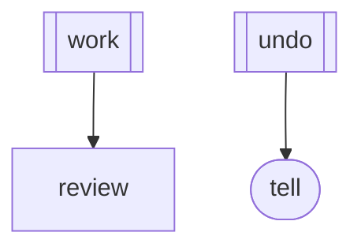

# Limits, failure and intervention

What happens when a step fails, runs out of time or reaches a bound, and
how a run is abandoned or changed from outside. Every one of these is a
call with a result on the record, so position after a resume is the same
as before it. The record itself is in
[record-and-replay.md](record-and-replay.md); calls and children are in
[calls-and-children.md](calls-and-children.md); questions and who answers
them are in [questions-and-judges.md](questions-and-judges.md).

## A failed step

A step has failed when its call returns anything that is not a result: an
error, a refusal, a timeout. A model step also fails when its model
reports with `flow_stuck` that it cannot do the step and the step draws
no edge or end for `stuck` (see [steps-and-data.md](steps-and-data.md)).

A failed step raises a `flow_ask` with the outcomes `retry` and `stop`
(`Question.Retry` is set).

- `retry` runs the step again as a new attempt, under a new call ID. A
  model step opens again, and its opening message names the attempt:
  `(run <key>, visit <n>, attempt <m>)`.
- `stop` fails the run.
- The host's rules (`Reply`) may answer. Unattended, with no rule that
  answers, the run fails.

A script killed part way leaves its call pending, and it may have run. A
tool that says a replay is safe is approved again and the run goes on.
One that does not cannot be approved; the host answers that the outcome
is unknown, which fails the step and raises the retry question.

## Failure at each level

A failed inner run never ends an outer one silently. Each run writes its
own end with its own reason.

| Event | In the run where it happens | In each run above it |
|---|---|---|
| a step fails | the retry question, under that run's key. `retry` runs it again; `stop`, or nobody to ask, ends the run `failed` | the call ends with the outcome `failed`. With an edge or end for `failed`, the caller goes on there with `{reason, workflow}` as data, and `step` when the callee's end names one. Without one, the calling step has failed and raises its own retry question; `retry` calls the callee again under a new key. With nobody to ask, that run fails too, its reason chained (`review: pr-review failed at gather: …`) |
| a visit bound, or a step that repeats itself | a person is asked to grant more; `stop`, or nobody to ask, ends the run `failed` | as for a failed step |
| a bound across the tree (depth, steps) | a person is asked to grant more, in the run that would cross it; `stop`, or nobody to ask, ends it `failed` | every run fails, with no retry question and no routing on `failed`, since a retry would cross the bound again |
| a call's timeout | every run the call waits on is abandoned, innermost first, each after its cleanup | the call ends `failed`, as for a failed step; a retry reads the clock again |
| an operator's `retry` or `jump` | the run's current step is run again, or the run goes to the step named | nothing |
| an operator's `abandon` | the run named and every run it called are abandoned, innermost first, each after its cleanup | the call that waited on the run named has failed; its caller asks whether to retry or routes on `failed` |
| a person's new invocation | `abandoned`, innermost first, each after its cleanup | `abandoned` |
| abort (the context is cancelled, `Agent.Abort`) | nothing is written; the run is still under way, and resumes | the same. A child's run is aborted, and its caller's call stays held |
| a pending question | the run ends `input_required` on that run's `flow_ask` | the caller is already `input_required` on its held `flow_call` |
| resume | replay gives the run's position, and it continues | a held `flow_call` names its child's key. `Drive` reopens the child from the store, continues it, and answers the caller's call when it ends, through each child in turn |

## Timeouts

`timeout` is a duration from 1ns to 24h (`MaxTimeout`). The clock decides
when the program takes the turn that says time ran out; what happened is
a call and its result. Replay reads a deadline from the record and never
from the clock.

### Which timeout holds a step

| Step | Its timeout |
|---|---|
| script or tool step | its own `timeout`; else its workflow's frontmatter `timeout` |
| model step | its own; else its workflow's; else, unattended, `UnattendedTimeout` (`DefaultUnattendedTimeout`, 30 minutes; 0 turns it off) |
| fresh model step | the same, held in its child: the workflow made for the step carries the step's timeout and its workflow's default |
| call (`flow:`) | its own `timeout` only, which bounds the run it calls and all that run calls. The frontmatter default does not apply |
| person step | its own `timeout`, which is the question's and needs `on_timeout`. The frontmatter default does not apply |
| judge | `timeout` on a judge is a load error. A judge's look is a model step in a child: unattended it takes `UnattendedTimeout`; attended it has no deadline of its own |
| cleanup step | as a script, tool or person step outside a cleanup. A cleanup is not held to the deadline of the call whose timeout abandoned its run |

Every step is also held to the deadline of each call it is nested in: the
earliest deadline wins.

### A script or tool step

It runs with a context that ends at its timeout. The host's tools are
wrapped in `Apply` (`agenttool.Wrap`, which keeps every property a tool
declares). A call cut off there returns
`agentflow: step "lint" timed out after 1m30s`, which is the call's
recorded output, so the step has failed and the retry question follows.
A tool that ignores its context is not stopped.

### A model step

- Before the model works on an attempt, the program calls `flow_clock`
  with `{run, step, timeout}` (ID `…_v<n>[-a<m>]-clock`). Its result,
  `{"deadline": "<RFC 3339>"}`, is what the attempt is held to. No working
  model is sent a `flow_clock` call.
- The model is told its time in its instructions.
- At the deadline the model's stream is cut off. It ends in
  `ErrStepTimeout`, which agentturn does not retry, and `Drive` continues
  the run. A tool the model calls during the step is cut off at the same
  deadline.
- The next turn is the program's: it calls `flow_clock` again with
  `expired` (ID `…-timeout`), and the error that call returns is the
  step's failure. The retry question follows. A retry is a new attempt
  with a deadline of its own.

### A call

- Before a call with a timeout starts the run it calls, the program calls
  `flow_clock` under the calling run's key (`…-clock`). Its result is the
  call's deadline.
- **`Drive` holds the child's runs to the deadline:** they run with a
  context that ends there, and so does every run they call, at any
  depth. A child that has ended in time is read as it ended. One that
  has not ended by the deadline, or that is waiting when `Drive` comes
  back to it later, a question included, is abandoned, each run after
  its cleanup, in its own session. Each one's end records the reason
  `timeout: call "<step>" of <workflow> ran past its timeout of <d>`. The
  held call is then approved with the failure and with what the child
  spent.
- **The failure is `failed`**, as any callee's is. A call that draws an
  edge for `failed` goes on there; one that does not has failed and asks
  to be retried, which reads the clock again for a new deadline.
- A run resumed after its call's deadline has passed is timed out on its
  first turn.

### A question

A person step's `timeout` and `on_timeout` are in
[questions-and-judges.md](questions-and-judges.md): the deadline is
recorded by `flow_clock` before the question is asked, the question
answers itself with the `on_timeout` outcome when `Drive` finds the
deadline passed, and a late `Answer` is refused with `ErrExpired`.
Nothing wakes a sleeping host: agentflow has no scheduler, so the host
drives the run when the deadline comes.

Timeouts are not bounds a person is asked to raise. A step that ran past
its timeout has failed, and the retry question already asks.

## Bounds

| Bound | `Question.Limit` | What it counts | Default | Set by | Whose |
|---|---|---|---|---|---|
| visits | `visits` | visits of one step in one run | 5 (`DefaultLoopVisits`) for a step on a loop | `max_visits` on any one node of the loop | the run's |
| repeat | `repeat` | a script or tool step giving the same outcome and data in a row | 3 (`RepeatLimit`) | not settable | the run's |
| depth | `depth` | how deeply calls nest; the root is 0 and each call adds 1 | 8 (`DefaultMaxDepth`) | `max_depth` in the root's frontmatter, `MaxDepth(n)`; the smaller wins | the tree's |
| steps | `steps` | every step entered across the tree | 200 (`DefaultMaxSteps`) | `max_steps` in the root's frontmatter, `MaxSteps(n)`; the smaller wins | the tree's |

### Visits

A node a path can come back to may run 5 times unless it says otherwise,
so a loop is bounded without every step saying so. `max_visits` on any
one node of the loop tightens or loosens it. A reached bound names the
step, the bound, where it came from and the edge taken.

### A loop a person drives

A loop that waits on a person at every pass cannot run away, so it may
say `max_visits: person` (`Node.PersonPaced`, with `MaxVisits` 0).

- **Paced.** A visit of a `max_visits: person` step is paced when, since
  that step's last visit in the same run, a person step of the run was
  answered by a person: an answer whose `by` is empty. Answers by the
  host's rules, a judge that decides, the `unattended` default or a
  timeout do not pace, so none of those can loop without a bound, and a
  judge's `max_returns` keeps its meaning. A person's answer under
  `shadow` or `advise`, or one a judge handed back, paces. A step's first
  visit is never paced, and neither is a visit an operator's jump makes.
- **No bound on a paced visit.** Paced visits are not held to the step's
  visit bound. Every other visit is, and that bound is
  `DefaultLoopVisits`. The visit number in call IDs still counts every
  visit; `State.Paced` says how many a person paced. A bound that is
  reached says how many paced visits went free.
- **No steps of the tree either.** A paced visit is not counted toward
  the tree's steps: `State.Entries`, and the `entries` a child's result
  carries, leave it out. Only that entry is exempt. A retry of the step,
  an operator's override and every visit of a step that is not
  `max_visits: person` count. `State.Entered`, which a run's summary
  counts, still takes in every step that ran.
- **Unaffected:** the repeat rule and timeouts.
- **Read from the record.** Whether a visit was paced is read from the
  steps the run has finished, in a called run and in a child each in its
  own run.
- **Only this run's person steps.** A person asked inside a workflow a
  step calls does not pace the caller's loop, since the caller reads only
  its call's result.
- **Checked at load, from the graph alone:** the step is on a loop; every
  cycle through it passes a person step (a person step passes its own),
  and an error names a cycle that passes none, such as
  `fix → check → fix`; `max_visits` is a number or `person`, not both; a
  step on a loop through a `max_visits: person` step with no `max_visits`
  of its own is an error, since it would stop that loop at the default:
  it says `person` too, or a number.

### A step that repeats itself

- A script or tool step that gives the same outcome and the same data
  `RepeatLimit` times in a row reaches the bound `repeat`. "In a row"
  counts that step's own results, with other steps between them: a loop
  where a fix and a check go round and the check finds the same thing
  each time.
- Calls to workflows are not counted, since what they return is the
  callee's.
- A result with no data is not counted. Only the visit bound holds such a
  loop.
- It is raised at the next step entered, and asked about there.
- It is the run's own bound: a failed run's caller may route on `failed`
  or retry.

### Steps across a tree

- Every step entered counts once toward the tree's total: retries, jumps
  and calling steps included, across every run of the tree. Paced visits are the one exception.
- The root's start records the bound.
- **A child is given what the tree has left.** A call, a fresh step
  and a judge's look each pass `max_steps` in their `flow_call` or
  `flow_judge` arguments, and the gate holds it to the record. The
  child's start records it as its own bound, 0 included.
- **Whatever came of the child, what it spent counts.** The held call is
  let go with `entries`, the steps the child's runs entered, and
  `granted`, what a person granted there, however the child ended:
  - a result carries them beside its outcome;
  - a failure is the output `{"failure": "<reason>", "entries": n,
    "granted": m}`, which is no result, so the step has failed;
  - a judge's verdict carries them, so the judge's look counts as its
    step.

  The caller's replay adds both. A child set aside by an invocation, an
  override or a timeout still counts: the counts are taken from the
  child's record once its run's end is written, after its cleanup. A
  kept child counts only the run of the visit it ended.
- A grant belongs to the run it was made in and to that run's tree. It
  does not carry into a later run nobody called in the same session.

### Depth

A call that would go deeper than the bound asks for more depth, in the
run that would make the call.

### Asking for more

Reaching any of the four bounds raises a `flow_ask` (ID
`…_v<n>[-a<m>]-limit<k>`) with:

- `limit` set to the bound's name;
- the outcomes `grant` and `stop`;
- a form for `grant`, `{amount}`, a whole number from 1 to 999;
- the question saying what was reached, and where.

Who answers:

1. the host's rules (`Reply`), recorded `by: rules`;
2. a person;
3. unattended, with no rule that answers, nobody: the run ends `failed`
   with the bound's error (`ErrVisits`, `ErrDepth`, `ErrSteps` or
   `ErrRepeat`).

No judge answers a bound.

The grant is read back from the record. A grant of `n` allows, for
visits, that step `n` more visits; for depth, `n` more levels below that
run; for steps, the tree `n` more steps; for a repeat, `n` more repeats.
After a grant the next bound reached is asked about in turn. `stop`
fails the run on that bound.

Depth and steps are the tree's bounds: a run that stops on one fails
every run it is nested in, which neither retries it nor routes on
`failed`. Visits and repeats are the run's own.

A host that wants a bound to fail at once answers `stop` with a `Reply`
rule on `Question.Limit`.

## Abandoning a run

A run that is abandoned ends with the status `abandoned`. A cancelled
context writes nothing, so it abandons nothing: the run is still under
way, and resumes.

| Cause | Which runs | The end's reason |
|---|---|---|
| a person's new invocation (`Invoke`, or an invocation message) | every run under way | none |
| an operator's `abandon` | the run named and every run it called | `overridden: abandon` |
| an operator's `retry` or `jump` over a step that holds a child | the child's runs | `overridden: retry`, `overridden: jump` |
| a call's timeout | every run the call waits on | `timeout: call "<step>" of <workflow> ran past its timeout of <d>` |
| the caller of a child was abandoned | the child's runs, in the child's session | the caller's reason |

The first reason a run is given stands.

**Across a tree, innermost first.** Each run is abandoned in its own
session. The program tells a child `agentflow: abandon`, or
`agentflow: abandon: <why>`, a developer message no model can write, sent
under a trigger of kind `workflow`. The child first has its own children
do the same, then runs its cleanup under its own key and writes its end,
and starts nothing. The caller's held call is then answered
`agentflow: abandoned` for an invocation, `agentflow: overridden` for an
override, or with the timeout's failure, with what the child spent; then
the caller runs its own cleanup and writes its end. Only then does a run
that was asked for start. A run that had already failed or finished
writes its end as it stands, with no cleanup.

After an invocation the new run starts. After an operator abandons the
run nobody called there is nothing to start until the workflow is invoked
again: the program says so, naming the run, and the conversation is then
the model's, with its tools and none of the workflow's, as after a run
that finished. A run that failed still waits for an invocation.

### Cleanup

A workflow may name, in its frontmatter, the step a cleanup path starts
at:

````markdown
---
on_abort: undo
---

````

The path is the steps reachable from `on_abort`. It runs when the run is
abandoned, for any cause above, before the run's end is written.

**It can never prevent the abort.**

- Its steps are script, tool and person steps only. It calls no workflow,
  has no model step and no judge, and has no loop. It is bounded by its
  length, so no bound is checked on it and it never asks for more.
- Nothing on the workflow's own path reaches it, and it reaches nothing
  on that path. Where it ends, the cleanup is over; its ends are no
  outcomes of the workflow.
- A cleanup step that fails is not asked about: the cleanup ends there.
- Whatever the cleanup comes to, the end is written next: `abandoned`,
  with `cleanup` saying `done`, `failed at <step>: <why>`, or
  `cut short: abandoned again`.

**A person step in a cleanup.**

- Attended, it is asked and waits like any question, and the run's end
  waits with it. A person who wants out answers it, or abandons again:
  the host refuses the pending question with `agentflow: abandoned`,
  which replay reads as the cleanup cut short, not failed.
- Unattended, it takes its `unattended` outcome. Without one the
  question cannot be answered, which fails the step, which ends the
  cleanup.
- In a child, a cleanup question is not put to anybody, since the person
  is in the session the abandon came from: the question is refused, the
  child is told again, and the cleanup ends there.

A cleanup step's `with` reads only what is certain wherever a run may be
abandoned: the inputs and the documents. A step of the workflow's path
is read with `optional` or `latest`, since it may not have run.

**Checked at load:** `on_abort` names a step, with the name that was
meant; no step of the cleanup is on the workflow's path; no cleanup step
is a model step, a call or a judged question; the cleanup has no loop.

**Record.** The cleanup's calls are under the abandoned run's key, after
whatever abandoned it, so `Runs` reads a run's span as reaching past an
invocation to its end. The next run's span starts at its own start.

## Operator overrides

An operator can change where a run stands in three ways.

| Action | What it does |
|---|---|
| `retry` | runs the current step of the run again, as a new attempt |
| `jump` | goes to the step it names, as a new visit, with a note |
| `abandon` | abandons the run and every run it called, innermost first, each with its cleanup |

```go
end, st, err := agentflow.OverrideRun(ctx, g, agent, agentflow.Override{
	Run: "3fa9c2d1e0", Action: agentflow.OverrideJump, Step: "fix",
	Note: "Fix only the null check; the rest is fine.",
})
```

**A request, then the program's call.** The host's request reaches the
program as a developer message, `agentflow: override {...}`, as an
invocation does, since no model can write one. The program's next turn is
a call, `flow_override`, under the key of the run under way, with the
request as its arguments. Its result says it was applied, or why not.
Replay applies an override only from that result. So the request, the
decision and its reason are on the record, a model cannot ask for an
override, and the gate refuses a `flow_override` no request is waiting
on. A request alone changes nothing. A request that was never applied
does not outlive the runs it was made over: a later invocation starts its
run without it.

**Which run.** An override names a run by its key.

- `retry` and `jump` change the innermost run under way, the only one at
  a step of its own. On a run that waits on one it called they are
  refused, naming that one.
- `abandon` may name any run under way. Its caller, if any, is not
  abandoned: the call ends `abandoned`, which fails the calling step, and
  the caller asks whether to retry it or routes on `failed`.
- A run in a child session is reached through the call that waits on it:
  `OverrideRun` opens the child and asks there, at any depth.

**Setting the run still.** Calls pending when the override is asked for
are set aside, and the children they wait on are abandoned as for an
invocation, each end recording `overridden: <action>`. A question set
aside so is not answered: if the override is refused it is put again
under a new ID; if applied, the override decides what comes next.

**A retry of a fresh step starts its work again.** The step's child is
abandoned and the new attempt calls a new one. The old child's session
stays, readable, with its end. A kept child (`child: <name>`) keeps its
session: only the run of the visit under way ends, and the next attempt
continues the same session, so its model reads what the abandoned
attempt did.

**Counts and bounds.** A retry is a new attempt and a jump a new visit.
Both count as step entries of the tree and both are held to every bound;
a jump is never a paced visit. A jump into a step at its visit bound
asks for more. A child set aside still counts, as under
[Steps across a tree](#steps-across-a-tree), so a bound cannot be dodged
by overriding and the count is the same after a resume.

**Where a jump may go.** Only where the step's inputs are on the record:
a jump to a step whose `with` cannot be resolved there is refused with
the reference that is missing. A jump never goes to a cleanup step.

**The note** reaches the step the override brought the run to, until it
finishes: a model step reads it in its opening message, before the tag
that names the visit; a fresh step's child in its instructions; a person
in the question's `note`. A program step records it and is not told.

**Refusals are results**, recorded with the reason: no such run under
way, a run that waits on another, no such step (with the name that was
meant), a step that cannot run from here, or runs already being
abandoned.
