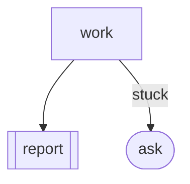

# Steps and data

What each kind of step does, what it is handed, what it produces, and how
data moves between steps. The keys are listed in
[workflow-format.md](workflow-format.md).

## Results

Every step ends in one result:

```json
{"outcome": "findings", "data": {}, "by": "", "reason": ""}
```

- `outcome` is one of the step's declared `outcomes`, `ok` when it
  declares none. Edges route on it.
- `data` is what later steps read as `steps.<id>.outputs`.
- `by` says who chose, where it was not the step's own turn-taker.
- `reason` is why, in the words of whoever chose: a person may give one
  with any answer (`Result.Reason`), and a judge that decides must. It is
  for whoever reads the record; `with` cannot refer to it.

A transcript carries no failure flag, so success has to be said. A
program or person step whose output is anything else, an error, a refusal
or an unknown outcome included, has failed. Failure and retry are in
[limits-failure-and-intervention.md](limits-failure-and-intervention.md).

## `with`

`with` is the step's inputs, by name. Each is a literal or one
expression.

| Step | Receives it as | Produces |
|---|---|---|
| script | one JSON object on stdin | its result, below |
| tool | arguments, merged over `args` | a result |
| call to a workflow | the callee's inputs | the callee's outputs |
| model | JSON in its instructions | `data` of `flow_finish` |
| person | shown beside the question | `data` of the answer |

`with` is what a step is handed, not all it can see. A model step reads
the whole transcript, earlier results included, unless its `context` is
`fresh`, when it works in a child session that sees only its `with`.

The program builds a call's arguments from recorded results, so no model
retypes a value on its way to a tool, and the call records exactly what
the step was given.

## Workflow inputs and outputs

A run's start records its inputs with every default it was not given
filled in (`Graph.InputDefaults`), so the record says what the run was
given and a resume reads it from there, whatever the definition says
later. An invocation, or a caller's `with`, may leave a defaulted input
out. A caller's `flow_call` records what the caller passed, and is held
to the callee's start by applying the same defaults.

A workflow's outputs are resolved from the record when the run ends, for
the outcome it ends with. Each outcome's outputs are checked at load on
every path into its end.

An output's schema is the schema of what it refers to, where every
outcome of the referenced step that declares the member agrees, and
untyped otherwise. Whether an output is present is read path by path, as
for any step's member. A caller is held to this contract; see
[calls-and-children.md](calls-and-children.md).

## Schemas

A step's `outputs` schema is checked where the data is made.

| Who makes the data | When it breaks the schema |
|---|---|
| a script or tool | the step fails |
| a model | it is given the schema as the parameters of `flow_finish`, and sees the error and can correct it |
| a person | the answer is refused and the question stays pending; the question carries the schema so a front can draw a form |
| the unattended default, or a timeout's | checked at load: its data is held to the same schema |

A model often sends nested `data` as a string holding JSON. Where the
schema wants an object or an array, the string is read first.

A value whose schema is not known until it is made, such as the untyped
output of a script passed to a call, is checked when it is used. A value
that breaks the schema then fails the step.

## Script steps

```yaml
run: scripts/gather-pr.sh
with:
  pr: ${{ inputs.pr }}
```

A script runs in an `agentworkspace.Workspace`, through the tool
`run_script` of package `script`. Only the program calls it: a model's
call, and a tool's nested one, are refused.

**What it is given.**

- `with`, as one JSON object on stdin.
- `$AGENTFLOW_SKILL_DIR`, the directory holding the run's snapshot of the
  skill. The script itself runs from the snapshot.
- `$AGENTFLOW_OUTPUT`, a file to write its result to.
- `$AGENTFLOW_PROGRESS`, a file to append progress to.

**Where it runs.** At the workspace's root, or in the step's `dir`: a
clean relative path below the root, literal or from a reference, resolved
from the record when the call is made and recorded in the call's
arguments. The script tool checks the directory exists before it runs.
The workspace's root does not move: the three paths above are absolute
where the workspace has a root on the host, and lead from the script's
directory where it has none. So a script can work in a worktree an
earlier script made.

A script of a workflow of another skill than the run's root names its
skill in the call (`ScriptCall.Skill`), and `script.Skills` gives the
tool each skill's files.

**Its result** is what it writes to `$AGENTFLOW_OUTPUT`, or its standard
output when it writes nothing there, so logs and results need not share a
stream.

- A step with no declared outcomes: exit 0 is `ok` and the result **is**
  the data, so `gh` or `jq` work unwrapped.
- A step with outcomes: the result is `{"outcome": ..., "data": ...}`.
- A non-zero exit, a result that is not one JSON value, or one over 1 MiB
  fails the step. Nothing is truncated.

Large data belongs in a workspace file, passed as its path and a hash, or
in a result whose step says with [`show`](#showing-part-of-a-result) what
a model sees of it.

### Progress

```sh
printf '{"progress": 2, "total": 5, "message": "testing"}\n' >> "$AGENTFLOW_PROGRESS"
echo 'linking' >> "$AGENTFLOW_PROGRESS"
```

A script appends progress to the file `$AGENTFLOW_PROGRESS` names, one
line for each update:

- a JSON object, `{"progress": …, "total": …, "message": …}`, any member
  left out, the numbers read as `agenttool.ProgressInfo` reads them;
- or a line of plain text, which is a message alone.

While the script runs, `run_script` reads the file every 100ms and
reports each complete line as a progress update of its call:
`agenttool.Progress`, with `ProgressInfo` as the details and the message
as the text (`2/5 testing`). The loop raises each as a `ToolUpdate`, as
for any long-running tool, so a front shows it beside the step. A last
line with no newline is reported when the script exits.

**Progress changes nothing.** No update reaches the record's items, so
position, `with` values, the result and control flow never see one, and
no model is sent one.

**The session keeps it, out of the transcript.** For each line it
reports, `run_script` calls `agenttool.WriteRecord` with a
`script.ProgressRecord` (`seq`, `progress`, `total`, `message`). The
recorder a host installs as `agentturn.Config.ToolRecorder` writes it at
once as a custom entry of namespace `agentflow:progress`
(`script.ProgressNS`), with `call_id` naming the script step's call.

- A front reads the custom entries of that namespace on the session's
  path, in order. `seq` counts the call's kept updates from 1. The
  entry's own time is when it was written.
- Custom entries are out of context: no item is rebuilt from them, so no
  request carries progress.
- Without a recorder on the call's context, nothing is written. A record
  that cannot be written costs a line of progress, never the script its
  run.

**Bounds.** None of these fails the step.

| Bound | Effect |
|---|---|
| a line over 4 KiB | not reported |
| past the file's first 1 MiB | not reported |
| a malformed JSON object | read as text |
| past a call's first 256 updates (`script.MaxKeptProgress`) | reported live, not kept |

The file is `.agentflow-progress-<id>` at the workspace's root, beside
the result file, and is removed when the call ends.

## Tool steps

```yaml
tool: git_tag
args: {sign: true}
with:
  name: ${{ steps.confirm.outputs.version }}
```

The program calls the named tool of the host's config with `args`, and
`with` merged over them. For a name both give, `with`'s value is the one
sent. A tool step takes no `dir`: its tool is the host's, built on the
host's workspace. `run_script` and the `flow_` tools cannot be named.

`Apply`, where the config's tools are known, reads the tool's
`Parameters()` schema and holds the step's arguments to it:

- **Every required parameter is given on every path**, by `args` or by
  `with`. A plain reference or a `latest` has a value on every path; an
  `optional` value may be left out, so it gives nothing for sure.
- **A name the tool does not declare** is an error where its schema
  forbids other properties (`additionalProperties: false`), with the name
  that was meant.
- **A literal holds to its parameter's schema**, an `args` member or a
  `with` literal alike.
- **A reference whose schema is known** must be of its parameter's type:
  the schema the outcome declares for the member it reads, where every
  outcome that declares it agrees. An integer may go where a number is
  wanted. A document is text.

Errors name the workflow, the step, the tool and the parameter.

Not checked at load, and checked by the tool's own validation when the
call is made: a config with a `ToolProvider`, whose tools are known only
as it runs; a reference with no schema, such as a script's untyped
output; and a parameter with no type. Tool steps of a workflow called
into a child are checked by the child's `Apply` against the child's
config.

## Showing part of a result

````markdown
## gather
```yaml
run: scripts/gather.sh
outputs:
  ok:
    summary: {type: string, required: true}
    rows: {type: array, required: true}
show: [summary]          # or: show: none
```
````

`show`, on a script or tool step, names the members of its result's data
that a working model sees. `show: none` shows the outcome alone. Without
`show`, a model sees the whole result.

- **The record keeps everything.** The step's call and its whole result
  are recorded as any step's are. Every step's `with` reads the whole
  data, so a later program step, and a model step that names the rows in
  its `with`, are handed all of them. What `with` hands a model step is
  in its instructions and is not narrowed: naming the rows is asking for
  them.
- **A model is sent a view.** Right after the result, before any turn a
  model could take, the program calls `flow_shown` with the run, the
  step, the visit and `of`, the call it shows. Its result is the outcome
  and only the members named, those the data has. A working model's
  requests leave out the call it shows and that call's result, and keep
  `flow_shown`.
- **No summary takes in the whole result.** A compactor is given only
  what a model may read; see [record-and-replay.md](record-and-replay.md).
- **A fresh child is unaffected.** It is sent what its call passes in,
  and its own steps' `show` holds in its own session.

**Position.** A step finishes on its result. `flow_shown` moves nothing
on: it is a view of a result the record already holds. While a result is
still to be shown, the program's next turn is its `flow_shown`, before
any other call, a run's end and a step's question included. A process
killed between the result and its `flow_shown` resumes with the result
still kept from the model: the program shows it first, and nothing runs
again.

**A failed result is not shown in part.** A result that fails its step,
one that breaks its schema say, is not a step's result: the retry
question quotes it, and a model reads that.

**A front** can show the whole result where it shows the step's call, and
mark `flow_shown` as what the model was sent of it, so a person sees what
the model did not.

## Model steps

A model step is the model working until it calls `flow_finish`. The prose
under its section is its prompt.

### What the model is sent

- **Instructions for the step**: the prompt, `with` as JSON, how to
  finish, the step's policy limits, the documents it may use and the
  skills it names.
- **Only the step's tools**, plus `flow_finish`, `flow_stuck` and the
  document calls the step is entitled to.
- **An opening message.** Each visit opens with a user message added by a
  hook, reading `agentflow: begin step "<id>".` and ending with the run
  and visit, so no two read alike. It says the earlier steps' results
  were accepted. It is a hook's message, so no record takes it for the
  person's.

### Finishing

The model ends the step with `flow_finish`, naming its run, the step, an
outcome and `data`. The schema of the step's `outputs` is the call's
parameters. A finish naming an undeclared outcome, or data that breaks
the schema, is an error the model sees and can correct.

### Context

A model step chooses what it reads with `context`:

- `session`: the conversation of its run's session, every earlier turn
  there. In a called workflow that begins with what the call's child
  opened with ([calls-and-children.md](calls-and-children.md)).
- `fresh`: a child session of its own. The step runs as a workflow of one
  step, named `<workflow>:<step>`, whose start, turns and finish are in
  the child. The caller holds a `flow_call` while it works and is given
  its result. The child has no other way to know anything, so `with` must
  carry what it needs.

`session` is the default, with one exception: a model step whose `model`
differs from its workflow's frontmatter `model`, or that names one when
the frontmatter names none, defaults to `fresh`. Another model would read
a conversation it did not write, without the reasoning behind it, and
take the earlier turns for its own. Saying `context: session` keeps it in
its run's session. This is decided from the definition alone, at load,
never from the host's config.

A message the person sends while a fresh step works is not in what that
step reads; the caller takes no prompt while it holds the call. A fresh
step does not limit its tools beyond what its child is given: with `read`
it can still look at anything its workspace holds.

A fresh step may take `dir`, `instructions` and `child`. Those, and how a
child is opened, are in [calls-and-children.md](calls-and-children.md).

### Model and thinking

````markdown
---
model: claude-sonnet-5-5
thinking: low
---
## review
```yaml
model: claude-haiku-5-5
thinking: high
```
````

- Any model step may set `model` and `thinking`. The workflow's
  frontmatter gives the defaults for its own steps. Otherwise the host's
  config decides. A callee uses its own defaults, not its caller's.
- `thinking` is one of `none`, `minimal`, `low`, `medium`, `high`,
  `xhigh` and `max`. `max` is openresponses' extension, sent as `xhigh`
  plus the extension member.
- Both are set on the request before it is recorded, so the record and
  the request hash hold them, and the host's model is asked for that
  name.
- The host option `Models(names...)` checks every step's model, every
  workflow's default and the judge's at `Apply`.
- A fresh step's child is given them in `ChildSettings.Model` and
  `Thinking`, and the one-step workflow made for the step takes the
  step's model as its own default, so the step does not open a child of
  its own child.

### Tools

````markdown
---
exclude_tools: [bash]          # no model step of the workflow is offered it
---

## look
```yaml
tools: all                     # every tool the host offers
exclude_tools: [fetch]
```
````

- `tools` lists the tools the model may call. With none, the step is
  offered none.
- `tools: all` offers every tool the host's config offers, except the
  program's own (`flow_*`, `run_script`).
- `exclude_tools`, on a model step and in the frontmatter for every model
  step and judge of the workflow, takes tools out of what the step is
  offered. The two add up: exclusion only narrows, so a step cannot take
  back what its workflow excludes.
- An excluded tool is removed from the request, so the model is never
  offered it, and a call to it anyway is refused like any tool the step
  does not allow. A policy's `deny` is different: a denied tool is still
  offered.
- A fresh step's child follows the same rule: `ChildSettings` gives the
  opener `Tools`, `AllTools` and `ExcludeTools` to build the child's
  tools from.

A call to a tool the step does not allow is refused. The host's own hook
still runs for allowed calls, and the step's `policy` narrows them
further; see [policy-and-trust.md](policy-and-trust.md).

### Skills

````markdown
## fix
```yaml
tools: [read, edit]
skills: [go-style, review-checklist]
```
Fix each finding.
````

A model step may name skills. Each one's instructions are added to the
step's, after its prompt:

```
Skills for this step, to follow as you do it:
<skill name="go-style">
…the skill's instructions…
</skill>
```

- **Found at load.** `workflow.LoadWith` finds each named skill with the
  `Find` it is given.
- **Pinned.** The text is `Skill.Instructions()`, its body and its list
  of files, read into the definition as `Node.Skills`. The digest pins
  exactly what the model is told, and a skill that changes on disk
  changes nothing already loaded. Loading again reads the new text under
  a new digest, which a run in progress refuses, as for any change to the
  definition.
- **In context and in children.** The step's instructions carry the
  skills wherever it runs. A kept child's steps may name different
  skills, since each visit's request is its step's own.
- **A skill grants nothing.** A skill's `allowed-tools` are not read. The
  step's tools are its `tools`, under the host's policy and the step's
  own. A skill's files are listed in its instructions, and the step reads
  them only with a tool the host offers it.
- **Only model steps.** A judge takes no `skills`: what a judge weighs is
  written in the step's `criteria`, where its reader sees it.

### Files

````markdown
## review
```yaml
files: [docs/spec.md, "${{ steps.gather.outputs.paths }}", ./prompts/style.md]
```
Review the change against the spec.
````

A model step may be given files when it opens, in the order written:

- **Workspace files**: a relative path, literal or from a reference to a
  path or a list of paths. In a child they are below the child's `dir`.
- **Files of the skill**: a path starting `./`, within the skill.

**Files of the skill are the loader's.** Loading reads each one from the
skill's snapshot into the definition (`SkillFiles`), so the digest pins
it. Anything wrong with one is a load error, never a failing step.

**Workspace files are read when the step opens**, by a call the program
makes: `flow_files`, with the step's run, its name and its files in
order. Its result holds every file's text, a skill's from the definition,
so what the model was given is in the record and replay never reads a
disk again. A run resumed after a kill sends the model the same texts
without a read.

- The program reads a workspace file through the host's own read tool
  (`read`, with its `path`, unless the host option `FileReader` names
  another), called with `agentturn.Invoke`, so the host's hooks see each
  read as a call of their own.
- A path a reference gives is checked when it is read: relative, clean
  and inside the workspace, or the child's `dir`.
- **A file that cannot be read fails the step**, which asks to be
  retried: a missing file, a path of the wrong shape, a refusal, a file
  over 256 KiB, or all of them over 1 MiB. Nothing is cut.
- **Each read is held to policy**: the step's, its calls' and its
  child's, as the step's own `read` would be. A refusal names the rule
  and its note, and the step fails with it. See
  [policy-and-trust.md](policy-and-trust.md).

**Where the model sees them.** For a `session` step, the program's call and its
result are in the conversation, after the step's opening message, and the
step's instructions say so. A compaction that folds them away does not
lose them: they are read from the record and put back after the opening
message of the request that needs them, which the record then holds as
sent. In a fresh child the call passes the files in, resolved by the
caller; the child's start records them, and the child's program makes the
`flow_files` call in the child's own session, with the child's read tool.

**Judges are given no files.** A judge that should read a file is told
its path in `with` and given a read tool.

### A model that is stuck



- Every model step, except a judge's, offers `flow_stuck` with
  `{run, step, reason}`, and its instructions say so.
- The result is the step's outcome `stuck`, with the data `{reason}`.
  `${{ steps.work.outputs.reason }}` is readable after it.
- `stuck` is reserved. No step declares it among its outcomes or outputs.
  A model step routes on it by drawing an edge or an end for it.
- With neither, it is a failed step (`the model reported it is stuck:
  <reason>`). That raises the retry question, and a retry opens the step
  again.
- `flow_finish` with the outcome `stuck` is refused, and the model is
  told to call `flow_stuck`.
- In a fresh step's child, the child ends with the outcome `stuck`, and
  the caller routes on it or fails the step.

### A model that stops

A config cannot keep a run going. `Drive` takes a run that ended and, if
a model step is still current, reminds the model once. The reminder is a
user message sent under a trigger of kind `workflow`: the record names
its source, and neither the loop nor a reader takes it for the person's.
A model that stops again is `ErrStalled`. An interactive host shows the
person what the model said and prompts with their reply; an unattended
one fails.

## Documents

A workflow declares named markdown documents in its frontmatter. Each
starts empty, from a file of the skill, or as one of the workflow's
inputs:

```yaml
---
inputs:
  brief: {type: string}
documents:
  plan: {from: templates/plan.md}
  brief: {input: brief}
  notes:
---
```

A step says which it works with:

````markdown
## draft
```yaml
documents:
  read: [brief, notes]
  edit: [plan]
```
Draft the plan.

## load
```yaml
run: scripts/load.sh
documents:
  write: {notes: text}
```
````

| Step | How it uses documents |
|---|---|
| model | lists what it may `read`, and what it may `edit`, which includes reading. It is given `flow_doc_read` and, with something to edit, `flow_doc_write`. Each takes the step's run and name and a document name the request's schema holds to the step's list. A write carries the document's whole new text. A write that follows the step's finish in the same response is refused: the step is over |
| script, tool | may `write` documents from members of its result's data, by document. A member that is not text fails the step |
| any step | reads a document's text with `${{ documents.<name> }}` in `with`. A document always has a text, empty at first, so the reference is certain everywhere |
| judge | reads no documents. A question shows one by naming it in `with` |

**A document's text is a pure function of the record.** Its first text is
in the definition, which the run's start pins: loading reads a `from`
file into it, so the digest covers it. After that, each change is a
call's result that holds the whole text: the model's write, or the
program step's result. A read's result holds the text too, so what the
model was shown is in the record. Replay keeps the text by run, and a
run reads only its own documents.

**Into a call, and back.**

- A called workflow gets a document's text as an input through `with`,
  and may start a document of its own from it (`input:`). It gives text
  back as an output, which the caller writes from its result.
- A fresh model step's call passes the texts of the documents the step
  reads into its child. The child's start records them, and the child's
  model reads and writes them by calls in its own session. The child's
  result carries back the texts of those the step edits, which the caller
  takes as its documents. The gate holds the passed texts to what the
  caller's record says.

**Compaction** loses no text: the text is read from the record, never
from what a model was sent. A model whose earlier read was folded away
reads again.

**Policy** does not reach documents, which are not files and which no
host tool touches. The step's `read` and `edit` lists are its limits, the
step's instructions state them, and a call outside them is refused with
the list it broke.

**Bounds.** A document's text is at most 1 MiB, its starting text
included. A longer write is refused, never cut.

**Documents and files.** Documents are the workflow's own named markdown,
edited by calls, their every version in the record. [Files](#files) are
read-only context from the workspace or the skill, read once when a step
opens. A step that should change a file is given a tool to write it; one
that should keep a draft keeps a document.

## Descriptions

```yaml
---
description: Review a pull request against what was asked for.
---
```

````markdown
## gather
```yaml
description: Fetches the diff and the issue it claims to close.
run: scripts/gather.sh
```
````

A `description` says what the workflow or the step is for, to the people
who read a run and to the fronts that show it. No model is sent it.

- **Where it lives.** In the definition: `Graph.Description` and
  `Node.Description`. The definition is pinned in `flow_start`, which no
  model is sent, so the description is pinned with it and changes the
  digest like any other part of the definition.
- **Where it is not.** In no instruction, opening message, question, call
  or note. A question's arguments are read by a model working in the same
  context later, so the description stays out of them as well. A fresh
  step's and a judge's child pin their own definitions, which carry the
  step's description, and no request of theirs holds it. Neither does
  what `SummaryFilter` hands a summarizer.
- **Where a front reads it.**
  - `Graph.Question(pending)` reads a pending question with its step's
    description, from the definition its run pinned, at any depth.
  - `State.Node.Description` is the current step's.
  - `Graph.Describe(step)`, on a run's pinned `Graph` from `Runs`, gives
    any step's, and `""` gives the workflow's.
- **Versions.** A description is part of its step's definition, so a
  question's `version` changes with it: what the person was shown
  changed.

## Writing steps that hold up

- A schema makes a model fill in a field, not look. A script can branch
  on what is reported and cannot know it is true.
- A step that can discard a finding is a silent single point of failure
  when unattended. Report what is dismissed.
