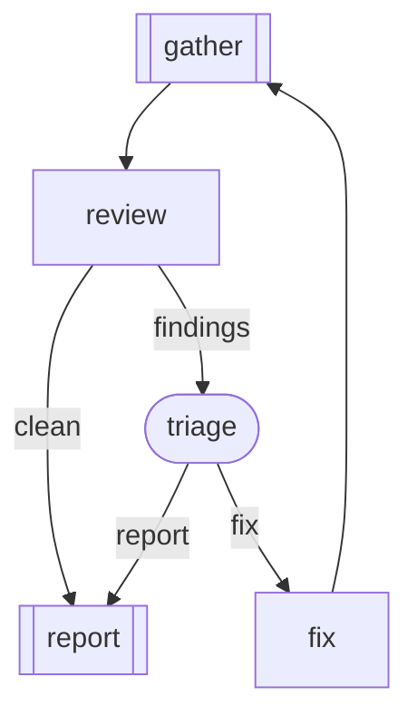

# The workflow format

How a workflow is written: the skill that carries it, the `WORKFLOW.md`
file, every key, the expression forms, schemas, and what loading checks.
What each setting does at run time is in the document its row links to.

## A workflow is a skill

A workflow reuses everything about Agent Skills: the directory layout, the
places skills are found, precedence, the `SKILL.md` frontmatter, bundled
files and the host's trust rules. Only the interpretation differs.

A skill is a workflow when its frontmatter says so:

```yaml
---
name: pr-review
description: Review a pull request against what was asked for.
metadata:
  agentflow: WORKFLOW.md
---
Prose telling a reader, or a model, how to do this by hand.
```

```
pr-review/
  SKILL.md
  WORKFLOW.md
  scripts/gather-pr.sh
```

- The marker lives in `metadata`, the skill specification's extension
  point, so the skill stays valid.
- The marker is explicit. A file that happens to be named `WORKFLOW.md`
  never turns a skill into something that executes.
- A catalog can list workflows apart from other skills without reading
  any file.
- A host with no workflow support loads an ordinary skill and follows the
  body. Authors should write the body so that works.
- A marker naming a missing or invalid file is an error. An aware host
  must not fall back to the body on an explicit invocation.
- The workflow is named for the skill. A script path is within the skill.
- A marked workflow that gives no `description` of its own takes the
  skill's.

### Loading

Package `workflow` loads a skill into a graph.

| Function | Does |
|---|---|
| `workflow.Load(skill)` | loads a workflow that reaches no other skill |
| `workflow.LoadWith(skill, find)` | loads it with every workflow skill it calls and every skill a step names, found by `find`, and links them |
| `workflow.FromCatalog(catalog)` | a `find` over an `agentskill.Catalog` |
| `workflow.Parse(name, src)` | reads one `WORKFLOW.md` into a graph |

Loading takes a snapshot of the skill's files. The graph's digest covers
all of them. Scripts run from the snapshot: it is written to a new
directory of the workspace for each run and removed after it, and
`$AGENTFLOW_SKILL_DIR` names that directory.

Loading a workflow also loads every workflow it can reach. A missing or
invalid one is a load error that names the chain of calls:
`take-issue → review → pr-reviw: no such workflow`.

### Workflow files within a skill

A step's `flow` names another workflow skill by its name, or a workflow
file in the same skill by a path starting `./`:

```yaml
flow: ./flows/triage.md
```

- The file has the format of a `WORKFLOW.md` and is taken from the
  skill's snapshot, so the skill's digest already covers it.
- Its workflow is named `<skill>/<path without .md>`, here
  `pr-review/flows/triage`. A workflow name may hold `/`.
- Its scripts are paths within the skill.
- It can be called only from within its skill: a skill's surface is its
  marked workflow.
- It has only its own `description`.

## WORKFLOW.md

The file holds frontmatter, exactly one `mermaid` block, and one `##`
section per node, headed by the node ID.

````markdown
---
inputs:
  pr: {type: integer, required: true}
---
# PR review



## gather
```yaml
run: scripts/gather-pr.sh
with:
  pr: ${{ inputs.pr }}
max_visits: 3
```

## review
```yaml
with:
  files: ${{ steps.gather.outputs.files }}
tools: [read, grep]
outcomes: [clean, findings]
outputs:
  findings:
    findings: {type: array, required: true}
```
Review the diff against what the session set out to do.

## triage
```yaml
with:
  findings: ${{ steps.review.outputs.findings }}
outcomes: [fix, report]
unattended: report
```
These are the findings. Fix them now, or just report them?

## fix
```yaml
with:
  findings: ${{ steps.review.outputs.findings }}
tools: [read, grep]
```
Fix each finding.

## report
```yaml
run: scripts/report.sh
```
````

### The diagram

Only this subset of Mermaid is accepted. Anything else is a load error
and is never ignored, so the picture cannot disagree with what runs.

| Syntax | Meaning |
|---|---|
| `flowchart TD` or `flowchart LR` | first line |
| `id[[label]]` | a program step: a script, a tool or a call to a workflow |
| `id[label]` | a model step |
| `id([label])` | a person step |
| `a --> b` | `a` ends with `ok`, then `b` |
| `a -->\|outcome\| b` | `a` ends with `outcome`, then `b` |
| `id((label))` | an end |
| `%% text` | a comment |

- One node or one edge to a line; edges do not chain.
- A node has one shape, given at least once.
- A label is free text, quoted if it likes, and means nothing.
- The first node mentioned is the start.
- Mermaid's keywords cannot be IDs: `end`, `graph`, `subgraph`,
  `flowchart`, `direction`, `style`, `linkStyle`, `classDef`, `class`,
  `click`, `default`.

### Ends

**A workflow's outcomes are its ends.** An edge into an end, written
`a -->|clean| clean((clean))`, ends the workflow with the end's ID as its
outcome. An outcome with no edge ends the workflow with that outcome's
own name. A caller routes on these outcomes; see
[calls-and-children.md](calls-and-children.md).

An end is not a node: it has no section and nothing leaves it. An end may
be named `failed`; reaching it ends the run `failed` with that outcome,
and it declares no outputs.

### Sections

A section may open with one `yaml` block of settings. The rest is prose,
which may hold headings below `##` and fenced blocks. The prose under a
model or person node is its prompt. A program node takes no prose, since
no model or person reads it: what the step is for goes under
`description`. A `yaml` block anywhere else, in a
section or before the first one, is an error, since it would look like
settings and be none.

## Frontmatter keys

| Key | Meaning | See |
|---|---|---|
| `description` | what the workflow is for, for people and fronts; no model is sent it | [steps-and-data.md](steps-and-data.md#descriptions) |
| `inputs` | the workflow's inputs, each a schema field that may take a `default` | [below](#inputs-and-outputs) |
| `outputs` | the workflow's outputs, the same for every outcome | [below](#inputs-and-outputs) |
| `outputs_by` | the workflow's outputs for each outcome, in place of `outputs` | [below](#inputs-and-outputs) |
| `documents` | the workflow's named documents and how each starts: `{from: <file of the skill>}`, `{input: <input name>}`, or empty | [steps-and-data.md](steps-and-data.md#documents) |
| `model`, `thinking` | the defaults of the workflow's own model steps | [steps-and-data.md](steps-and-data.md#model-and-thinking) |
| `timeout` | the default deadline of every script, tool and model step | [limits-failure-and-intervention.md](limits-failure-and-intervention.md) |
| `exclude_tools` | tools no model step or judge of the workflow is offered | [steps-and-data.md](steps-and-data.md#tools) |
| `context` | `fresh`: every call to this workflow opens its child with nothing of the caller's. No other value is allowed | [calls-and-children.md](calls-and-children.md) |
| `hidden` | `true`: only a workflow that calls it runs it | [calls-and-children.md](calls-and-children.md) |
| `on_abort` | the step a cleanup path starts at when the run is abandoned | [limits-failure-and-intervention.md](limits-failure-and-intervention.md) |
| `max_depth` | how deep calls may nest below this workflow; 8 if absent | [limits-failure-and-intervention.md](limits-failure-and-intervention.md) |
| `max_steps` | how many steps a run and everything it calls may enter; 200 if absent | [limits-failure-and-intervention.md](limits-failure-and-intervention.md) |

## Node settings

| Key | Nodes | Meaning | See |
|---|---|---|---|
| `description` | all | what the step is for, for people and fronts | [steps-and-data.md](steps-and-data.md#descriptions) |
| `with` | all | the step's inputs, by name | [steps-and-data.md](steps-and-data.md#with) |
| `outcomes` | all | ways the node can end; `[ok]` if absent | [steps-and-data.md](steps-and-data.md#results) |
| `outputs` | all but a call | schema of the step's data, by outcome | [below](#schemas) |
| `max_visits` | all | how often the node may run, 1 to 99; if absent, 5 for a node on a loop and 1 for any other; `person` for a loop a person drives | [limits-failure-and-intervention.md](limits-failure-and-intervention.md) |
| `timeout` | script, tool, model, person, call | a duration past which the step fails and asks to be retried; on a person step, past which the question takes `on_timeout`; on a call, past which the runs it waits on are abandoned | [limits-failure-and-intervention.md](limits-failure-and-intervention.md) |
| `run` | program | a script, by its path within the skill | [steps-and-data.md](steps-and-data.md#script-steps) |
| `tool`, `args` | program | a tool to call, with fixed arguments | [steps-and-data.md](steps-and-data.md#tool-steps) |
| `flow` | program | a workflow to call: a skill's name, or `./<path>.md` in this skill | [calls-and-children.md](calls-and-children.md) |
| `show` | script, tool | the members of the result's data a working model sees: a list of names, or `none` | [steps-and-data.md](steps-and-data.md#showing-part-of-a-result) |
| `documents` | model; script, tool | on a model step, `read` and `edit` lists; on a script or tool step, `write`, a map from document to the result member it takes | [steps-and-data.md](steps-and-data.md#documents) |
| `tools` | model | tools the model may call: a list, or `all`; none if absent | [steps-and-data.md](steps-and-data.md#tools) |
| `exclude_tools` | model | tools the step is never offered, whatever `tools` says | [steps-and-data.md](steps-and-data.md#tools) |
| `skills` | model | skills whose instructions are added to the step's | [steps-and-data.md](steps-and-data.md#skills) |
| `files` | model | files given to the step as context when it opens | [steps-and-data.md](steps-and-data.md#files) |
| `model`, `thinking` | model; `model` also a call | the model a step asks and how hard it reasons. On a call, the model of the callee's steps where the callee's frontmatter names none; another model than the workflow's makes the call `context: fresh` unless it says `session` | [steps-and-data.md](steps-and-data.md#model-and-thinking) |
| `context` | model, call | `session` or `fresh`. On a model step, whether it works in its run's session or in a child of its own. On a call, whether its child opens with the caller's view or with nothing | [steps-and-data.md](steps-and-data.md#context), [calls-and-children.md](calls-and-children.md#context-what-a-child-opens-with) |
| `dir` | fresh model, call, script | the directory below the workspace's root the step works in: a path, or a reference to one | [calls-and-children.md](calls-and-children.md) |
| `instructions` | fresh model, call | a file of the skill added to the child's instructions | [calls-and-children.md](calls-and-children.md) |
| `child` | fresh model | the name of a child kept across the visits and steps that name it | [calls-and-children.md](calls-and-children.md) |
| `policy` | model, call | `allow` and `deny` lists of rules; a rule is a string, or `{rule, note, path, command}` | [policy-and-trust.md](policy-and-trust.md) |
| `unattended` | person | the outcome taken when nobody can be asked: a name, or `{outcome, data}` | [questions-and-judges.md](questions-and-judges.md) |
| `on_timeout` | person | the outcome a question takes when its timeout passes unanswered: a name, or `{outcome, data}` | [questions-and-judges.md](questions-and-judges.md) |
| `choices` | person | values an answer picks from, one or many | [questions-and-judges.md](questions-and-judges.md) |
| `text` | person | the outcome an answer in the person's own words takes: a name, or `{outcome, as}` | [questions-and-judges.md](questions-and-judges.md) |
| `judge` | person | that a model may answer: `criteria`, `outcomes`, `tools`, `max_returns`, `policy` | [questions-and-judges.md](questions-and-judges.md) |

A program node has exactly one of `run`, `tool` and `flow`.

## Values and expressions

The vocabulary follows GitHub Actions, so it reads as familiar. It is not
compatible with it.

A value is a literal or exactly one `${{ }}` expression. There are no
operators, no interpolation, no other functions and no `if:`.

| Expression | Value | In Go |
|---|---|---|
| `${{ ref }}` | the reference's; it must exist on every path here | `From` |
| `${{ latest(a, b, ...) }}` | of the references with a value, the one whose step finished last; at least one must exist on every path | `Latest` |
| `${{ optional(a, ...) }}` | the same, and the argument is left out when none has a value | `Optional` |

A reference is one of:

| Reference | Reads |
|---|---|
| `inputs.<name>` | an input of the run, optionally followed by member names |
| `steps.<id>.outputs` | the data of the step's latest result, optionally followed by member names |
| `documents.<name>` | a document's current text |

- A reference reads the **latest** result of a step, since a graph may
  loop.
- `latest` is for a step that several branches reach: a plan that was
  drafted, revised or loaded from disk is one argument each.
- `optional` is for what a loop has not produced yet, such as the errors
  that sent a step back.
- An input is older than any step's result. A document's write is newer
  than the steps finished before it.
- Numbers are kept as written.

The one place a value is put into text is a person step's question, which
may hold these expressions; see
[questions-and-judges.md](questions-and-judges.md). A model step's prompt
takes none: its values go through `with`.

## Inputs and outputs

```yaml
---
inputs:
  pr:   {type: integer, required: true}
  base: {type: string, default: main}
outputs:
  summary: ${{ steps.score.outputs.summary }}
---
```

**Inputs** are schema fields. An input that is not required may take a
`default`:

- A `default` is a literal, held to the input's schema at load.
- `required` with `default` is a load error.
- Only a workflow's inputs take one. A step's outputs, or a member nested
  in an input, saying `default` is a load error.
- A plain `${{ inputs.base }}` is certain on every path, as a required
  input's is.

**Outputs** are values. `outputs` gives the same outputs for every
outcome. `outputs_by` gives them by outcome instead, as a step's schemas
are:

```yaml
outputs_by:
  clean:
    summary: ${{ steps.score.outputs.summary }}
  findings:
    findings: ${{ steps.review.outputs.findings }}
    summary: ${{ steps.score.outputs.summary }}
```

A workflow gives one or the other; both is a load error. No outputs are
asked for on an unrouted `failed`, and an end named `failed` declares
none.

## Schemas

A step's `outputs` gives, by outcome, the schema of its data. The inputs
of a workflow use the same field form.

```yaml
outputs:
  findings:
    findings: {type: array, required: true, items: {type: string}}
    severity: {type: string, enum: [low, high]}
```

| Field key | Meaning |
|---|---|
| `type` | `string`, `number`, `integer`, `boolean`, `array` or `object` |
| `required` | the member must be present |
| `description` | text for whoever fills it in |
| `enum` | the values allowed |
| `items` | the schema of an array's members |
| `properties` | the members of an object, each a field |
| `default` | a workflow input only |

The schema is `agenttool.Schema`. It has no `pattern` and no numeric
bounds. Where each kind of step's data is held to its schema is in
[steps-and-data.md](steps-and-data.md#schemas).

## Checked at load

Unknown keys are errors everywhere: every key of the frontmatter and of a
section's settings, at any depth (`judge`, `policy`, a schema field, the
forms of `unattended`, `choices`, `text` and `on_timeout`), is checked
against what that place takes, with its line.

Some checks need more than the file. `Graph.Validate` checks one graph;
`Graph.Link` checks calls once the workflows they name are known; `Apply`
checks what depends on the host's config. `Apply` refuses a graph that
calls and is not linked.

### Structure

| Check | |
|---|---|
| the diagram | only the accepted subset; one shape per node; a section for every node and no section for anything else |
| edges | an edge to an unknown node; an edge or end for an outcome the node does not declare; anything leaving an end |
| kinds | a setting on a kind of node that does not take it (the Nodes column above) |
| `stuck` | declared among a step's outcomes or outputs; it is reserved for `flow_stuck` |
| `max_visits` | outside 1 to 99; `person` where no person paces the loop, see [limits-failure-and-intervention.md](limits-failure-and-intervention.md) |
| `on_abort` | a step that does not exist, or a cleanup path that is not allowed; see [limits-failure-and-intervention.md](limits-failure-and-intervention.md) |

### References

- Every plain reference must have a value on every path that reaches it:
  the step has certainly run, and where it declares schemas, the member
  is `required` by the outcome that was taken.
- For `latest`, every path must bring at least one of its references.
- The references of `latest` and `optional` must each be able to exist: a
  declared step or input, and a member some outcome declares. A misspelt
  name is not read as absent.
- A loop that can re-run a step with another outcome loses the first
  outcome's members.
- A workflow's `outputs` are checked at every way out: each outcome's
  outputs on every path into its end.
- `steps.<id>` to no step, `inputs.<name>` to no input and
  `documents.<name>` to no declared document are errors.
- A literal `with` value, an input `default` and an `unattended` or
  `on_timeout` outcome's data hold to their schemas.

### Step settings

| Setting | Checked |
|---|---|
| `dir` | a literal is relative and clean, with no `..`; a reference has a value on every path and, where its schema is known, is a string; `optional(...)` is an error |
| `model`, `thinking` | `thinking` is one of the levels; with the host option `Models`, every step's model, every workflow's default and the judge's are names the host serves |
| `tools`, `exclude_tools` | `tools: all` with a list; naming and excluding the same tool, directly or through the workflow; a judge naming a tool its workflow excludes; excluding the program's own tools |
| `skills` | on anything but a model step; a skill that cannot be found, whose instructions cannot be read, or that says nothing; naming one when loading with `Load`, which has nothing to find skills with |
| `files` | a workspace path that is not relative, clean and inside the workspace; a reference whose known schema is not a path or a list of paths; a `./` file that is not in the skill, is a directory, leaves the skill, is over 256 KiB or is not UTF-8 text |
| `documents` | an undeclared document in a list, a `write` or a reference; `read` or `edit` on anything but a model step; `write` on anything but a script or tool step; a `from` that is not a clean path in the skill, or not in it; an `input` that is not a text input of the workflow; a written member no outcome declares, or that is not text |
| `show` | on a model step, a person step or a call; a member no outcome of the step declares; a member named twice; naming members without declared outputs; `show: []`, or a value that is neither `none` nor a list |
| `policy` | a rule naming a tool the step does not offer, except `read` on a step given workspace files; see [policy-and-trust.md](policy-and-trust.md) |
| `timeout` | on a judge; a duration that does not parse or is out of range |
| person keys | see [questions-and-judges.md](questions-and-judges.md) |

### Calls, at link

A call's inputs, outcomes and the data read from it are held to the
callee's contract, and a child's settings on a call are checked once it
is known which calls run fresh. See
[calls-and-children.md](calls-and-children.md).

### Against the host's config, at `Apply`

- A tool a step names must be one the config offers: a program step's
  `tool`, the `tools` of a model step working in its run's session, the
  script tool where a step runs a script, and the read tool where a step
  is given workspace files.
- Every excluded tool name must be one the config offers.
- A tool step's arguments are held to its tool's parameters; see
  [steps-and-data.md](steps-and-data.md#tool-steps).
- A step whose skill or skill file was never read, as in a graph built
  by hand that names one and gives no text, is refused.
- A hidden workflow is refused as a root.

These hold for the graph itself. A workflow it calls works on its
child's tools: `Child.Apply` makes the same checks against the child's
config. A config with a `ToolProvider` names its
tools only as it runs, so its tool names and arguments are checked when
each call is made.

### Errors that name what was meant

```
workflow: node "review": line 3: unknown key "outcome"; did you mean "outcomes"?
agentflow: node "fix": edge to unknown node "gathr"; did you mean "gather"?
agentflow: node "fix": steps.reveiw.outputs.findings: no step "reveiw"; did you mean "review"?
```

Every load error that names something unknown ends, when one name is
close enough to be what was meant, with `; did you mean "x"?`.
`agentflow.Suggest(name, among)` says it: the closest name by edit
distance, at most 2 edits and at most a third of the name's length (1 for
a short one), the first in order on a tie, and nothing when none is that
close, since a guess at something unrelated misleads.

It covers keys, nodes, outcomes, references and their members, workflows,
workflow files, skills, documents, tools, models and a step a host option
names.

## Building in Go, and writing back

A `Graph` built in Go is the same graph a file loads into: `Node` values
with a `Kind` of `Run`, `Agent` or `Person`, and values made with `From`,
`Latest`, `Optional` and `Literal`. `Graph.Validate` and `Graph.Link`
check it as loading does.

`workflow.Format(graph, title)` writes a graph back out as a
`WORKFLOW.md`. It draws every end whose name differs from the outcome
that reaches it, and one for each ending outcome of a step that
branches. It writes `instructions` and skill files back by name. A graph
that cannot be written as a file without changing it is an error.
