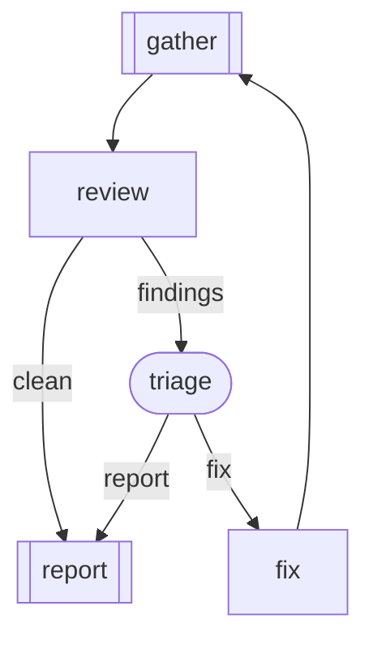

# RFC 0001: agentflow, program-driven workflows over the agent loop

Status: draft. Sections marked **spiked** are implemented and tested in
this repository. Everything else is proposed and untested.

## Summary

A workflow is a graph that decides who takes each turn: the **program**,
the **model** or a **person**. All three write to one transcript and one
session. Handing a turn to the model or a person and continuing when
they finish is the same operation as any other step.

Workflows are authored as Agent Skills that carry a `WORKFLOW.md`: a
Mermaid diagram for control flow and a section per node.

## Goals

- The same workflow runs interactively or unattended.
- Control flow is deterministic: it depends only on the definition and
  on recorded results.
- A person can read, write and review a workflow. A program or a model
  can generate one.
- Resume in another process needs the session and the definition, and
  nothing else.
- Nothing in agentturn, agentskill or the session format has to change.

## Non-goals

- General BPMN. Timers, message correlation and parallel gateways are
  left out until something can schedule and join them.
- An expression language.
- A scheduler or run service.

## Packaging: a workflow is a skill

A workflow reuses everything about Agent Skills: the directory layout,
the places skills are found, precedence, the `SKILL.md` frontmatter,
bundled files, `allowed-tools` and the host's trust rules. Only the
interpretation differs.

A skill is a workflow when its frontmatter says so:

```yaml
---
name: pr-review
description: Review a pull request against what was asked for.
metadata:
  agentflow: WORKFLOW.md
---
Prose telling a reader, or a model, how to do this by hand.
```

```
pr-review/
  SKILL.md
  WORKFLOW.md
  scripts/gather-pr.sh
```

- `metadata` is the specification's extension point, so the skill stays
  valid. A new top-level frontmatter key would be a validation error.
- The marker is explicit. A file that happens to be named `WORKFLOW.md`
  never turns a skill into something that executes.
- The marker is visible in the frontmatter, so a catalog can list
  workflows apart from traditional skills without reading any files.
- A host with no workflow support loads an ordinary skill and follows
  the body. Authors SHOULD write the body so that works.
- A marker naming a missing or invalid file is an error. An aware host
  MUST NOT fall back to the body on an explicit invocation.
- The workflow is named for the skill. A script path is within the skill.
- Loading (package `workflow`, spiked) takes a snapshot of the skill's
  files. The graph's digest covers all of them, and scripts run from the
  snapshot, written to a new directory of the workspace for each run and
  removed after it. `$AGENTFLOW_SKILL_DIR` names it; the script starts at
  the workspace's root.

An aware host offers two ways in. **Explicit**: a command such as
`/pr-review`, or a call from code. **Dynamic**: the model asks for a
workflow skill, which ends its turn and starts the workflow instead of
returning the body.

## WORKFLOW.md

The file holds exactly one `mermaid` block and one `##` section per
node, headed by the node ID. Frontmatter declares the workflow's inputs
and outputs.

````markdown
# PR review



## gather
```yaml
run: scripts/gather-pr.sh
max_visits: 3
```

## review
```yaml
with:
  files: ${{ steps.gather.outputs.files }}
tools: [read, grep]
outcomes: [clean, findings]
outputs:
  findings:
    findings: {type: array, required: true}
```
Review the diff against what the session set out to do.

## triage
```yaml
with:
  findings: ${{ steps.review.outputs.findings }}
outcomes: [fix, report]
unattended: report
```
These are the findings. Fix them now, or just report them?

## fix
```yaml
with:
  findings: ${{ steps.review.outputs.findings }}
tools: [read, grep]
```
Fix each finding.

## report
```yaml
run: scripts/report.sh
```
````

### Accepted Mermaid

Only this subset. Anything else is a load error and is never ignored,
so the picture cannot disagree with what runs.

| Syntax | Meaning |
|---|---|
| `flowchart TD` or `flowchart LR` | first line |
| `id[[label]]` | the program runs a tool or script |
| `id[label]` | the model works |
| `id([label])` | a person decides |
| `a --> b` | `a` ends with `ok`, then `b` |
| `a -->\|outcome\| b` | `a` ends with `outcome`, then `b` |
| `%% text` | a comment |

One node or one edge to a line; edges do not chain. A node has one shape,
given at least once. A label is free text, quoted if it likes, and means
nothing. The first node mentioned is the start. An outcome with no edge
ends the workflow. Mermaid's keywords (`end`, `graph`, `subgraph`,
`flowchart`, `direction`, `style`, `linkStyle`, `classDef`, `class`,
`click`, `default`) cannot be IDs. That Mermaid itself draws every file
this accepts has not been verified.

### Loops

A node a path can come back to may run 5 times unless it says otherwise,
so a loop is bounded without every step saying so. To tighten or loosen
it, set `max_visits` on any one node of the loop. Reaching a bound fails
the workflow with an error naming the step, the bound, where it came
from and the edge taken.

### Sections

A section may open with one `yaml` block of settings. The rest is prose,
which may hold headings below `##` and fenced blocks. A `yaml` block
anywhere else in a section is an error, since it would look like settings
and be none. Unknown keys are errors.

### Node settings

| Key | Nodes | Meaning |
|---|---|---|
| `run` | program | script path within the skill |
| `tool`, `args` | program | a tool to call instead, with fixed arguments |
| `with` | all | the step's inputs, by name |
| `outputs` | all | schema of the step's data, by outcome |
| `tools` | model | tools the model may call; none if absent |
| `context` | model | `session`, `fresh`, or a list of node IDs (proposed; refused today) |
| `outcomes` | all | ways the node can end; `[ok]` if absent |
| `unattended` | person | outcome, and data, taken when nobody can be asked |
| `max_visits` | all | how often the node may run; if absent, 5 for a node on a loop and 1 for any other |

The text under a model or person node is its prompt.

## Data (spiked)

The vocabulary follows GitHub Actions, so it reads as familiar. It is not
compatible with it.

```yaml
inputs:                      # frontmatter, as workflow_call has
  pr: {type: integer, required: true}
outputs:
  summary: ${{ steps.score.outputs.summary }}
```

```yaml
tool: git_tag
args: {sign: true}
with:
  name: ${{ steps.confirm.outputs.version }}
```

A value is a literal or exactly one `${{ }}` reference, to `inputs.<name>`
or `steps.<id>.outputs`, optionally followed by member names. There are
no operators, functions, interpolation or `if:`: a decision is a step
with a named outcome, so every branch is in the diagram. In Go a
reference is `From("steps.confirm.outputs.version")`.

A reference reads the **latest** result of a step, since a graph may loop.

### What each kind does with `with`

| Step | Receives it as | Produces |
|---|---|---|
| script | one JSON object on stdin | its result, below |
| tool | arguments, merged over `args` | a result |
| model | JSON in its instructions | `data` of `flow_finish` |
| person | shown beside the question | `data` of the answer |

`with` is what a step is handed, not all it can see. A model step reads
the whole transcript, earlier results included, until `context` is
implemented.

The program builds a call's arguments from recorded results, so no model
retypes a value on its way to a tool, and the call records exactly what
the step was given. Numbers are kept as written.

### Script results

A script's result is what it writes to `$AGENTFLOW_OUTPUT`, or its
standard output when it writes nothing there, so logs and results need
not share a stream.

- A step with no declared outcomes: exit 0 is `ok` and the result **is**
  the data, so `gh` or `jq` work unwrapped.
- A step with outcomes: the result is `{"outcome": ..., "data": ...}`.
- A non-zero exit, a result that is not one JSON value, or one over 1 MiB
  fails the step. Nothing is truncated.

Large data belongs in a workspace file, passed as its path and a hash.

Scripts run in an `agentworkspace.Workspace` (package `script`), as the
tool `run_script`. Only the program calls it: a model's call, and a tool's
nested one, are refused.

### Schemas and forms

A step's `outputs` schema is checked where the data is made. A model
often sends nested `data` as a string holding JSON; where the schema
wants an object or an array, the string is read first. A script or
tool that breaks it fails the step. A model is given the schema as the
parameters of `flow_finish` and sees the error. A person's answer that
breaks it is refused and the question stays pending; the question carries
the schema so a front can draw a form. The unattended default carries
data held to the same schema.

The schema is `agenttool.Schema`: types, enums, required members and
nesting. It has no `pattern` or numeric bounds.

**Secrets are never data.** Everything here is in the transcript and can
reach a model.

### Checked at load

Every reference must have a value on every path that reaches it: the step
has certainly run, and where it declares schemas, the member is
`required` by the outcome that was taken. A loop that can re-run a step
with another outcome loses the first outcome's members. A workflow's
`outputs` are checked at every way out. Whether `with` covers what a
tool requires is not yet checked.

A Go builder constructs the same graph, and the graph can be written
back out as `WORKFLOW.md`.

## Execution (spiked)

`Apply(graph, config)` returns an `agentturn.Config`. There is no second
engine: `Prompt`, `Resume`, hooks, recording and the fronts work as they
do for any config.

- `BeforeModelCall` reads where the workflow stands and shapes the
  request. A program or person turn is sent to the model name
  `agentflow/<workflow>`; a model turn gets the node's prompt and only
  the node's tools.
- A router `Model` answers `agentflow/` requests itself by emitting the
  node's function call, and passes every other request to the real
  model.
- `BeforeToolCall` refuses calls the node does not allow and defers a
  person's question. The config's own hook still runs for allowed calls,
  so policy applies to program steps.

The model name is set before the turn is recorded. The record therefore
shows which turns the program took, and request hashes reproduce.

### An instance

The first call of an instance is `flow_start`, which carries the
workflow's name and the digest of its definition. Replay begins there,
so whatever the transcript held before is ignored. Resuming with a
definition whose digest differs is refused.

A transcript with no instance starts one. Another begins only at an
invocation, a developer message reading `agentflow: start <name>`
(`Graph.Invocation`), which a model cannot write. It also abandons an
unfinished instance. After an instance has finished and said so, a plain
prompt is a conversation with the model, with its tools. An instance
that failed stays failed until an invocation.

### Results

Every step ends in one result:

```json
{"outcome": "findings", "data": {}, "by": ""}
```

A transcript carries no failure flag, so success has to be said. A
program or person step whose output is anything else, an error, a
refusal or an unknown outcome included, has failed. A model finishes
with `flow_finish`; a finish naming an undeclared outcome is an error
the model sees and can correct.

### Failure

A failed step raises a `flow_ask` with the outcomes `retry` and `stop`.
`retry` runs the step again under a new call ID. `stop` fails the
workflow. The host's rules may answer; unattended, with no rule that
does, the workflow fails.

### Position

Position is a pure function of the graph and the transcript. Program
steps are matched by call ID
(`flow_<workflow>_<instance>_<node>_v<visit>`, with `-a<attempt>` on a
retry), model steps by a successful `flow_finish` naming the node, made
after the node became current, so one model turn cannot finish a step it
has not yet been given. Nothing else is stored. Names are bounded, 16
characters for a workflow and 20 for a node, because providers limit
call IDs.

Position needs every earlier step, so a transform that drops any of them,
a compaction among them, is refused. Long workflows cannot be compacted
until position is read from the session path instead (proposed). A
transform that records its fold before returning may still have written
it.

### Answering a question

A person step is a `flow_ask` call held by a `hold` decision, so the run
ends `input_required`. `Answer` approves it with the answer added to the
arguments, and the tool returns it. The record reads `hold by policy`,
then `proceed by human`. Supplying the output directly would be recorded
as `reject`, which is what the format says of any output a caller writes
for a call that did not run.

### A model that stops (spiked)

A config cannot keep a run going, so `Drive` takes a run that ended and,
if a model step is still current, reminds the model once. The reminder is
a user message sent under a trigger of kind `workflow`: the record names
its source, and neither the loop nor a reader takes it for the person's.
A model that stops again is `ErrStalled`. An interactive host shows the
person what the model said and prompts with their reply; an unattended
one fails.

## Interactive and unattended

When a question is reached, the host tries in order:

1. its own rules (`Reply`), marked `by: rules` in the result and decided
   `by: policy` in the record (spiked)
2. unattended, the node's `unattended` outcome, marked `by` (spiked)
3. waiting: the run ends `input_required` (spiked)

The working model never answers on a person's behalf.

## Context (proposed)

A workflow records into its own child session, linked to the session it
was invoked from, which it leaves untouched. A model node chooses what
it sees: `session` (the invoking conversation), `fresh` (only its
inputs) or named node results. A reviewer that inherits a session also
inherits its blind spots, so both have uses.

## Determinism and trust

- `flow_start` records a digest of the graph, which for a skill covers
  every file in it (spiked). Approving a workflow is approving a digest.
- Branches use only recorded outcomes. Time, randomness and anything
  clever belong in a script whose result is recorded.
- A workflow from a repository is repository code that runs at fixed
  points. It needs approval by digest before its first run (proposed).

## Spike findings

Offline, with a scripted model:

- A session recorded with `agentturn/session` survives SIGKILL while a
  question is pending. A new process resumes from the store, completes
  the workflow and runs only the remaining steps. All request hashes
  reproduce.
- SIGKILL during a model turn: `Continue` finishes the workflow.
- SIGKILL during a script: the call is pending and may have run. A tool
  that says replay is safe is approved and the workflow goes on. One
  that does not cannot be approved; answering that the outcome is
  unknown fails the step, which asks whether to retry.
- Loops, visit limits, failed scripts, policy deferral of a program step
  and the unattended default behave as described.
- Fixed: one model turn could finish two steps; a transform could send
  the workflow back to its start.
- No change to agentturn or the session format was needed.

With real models, one model step with two outcomes after a program step,
8 trials each (6 for the local model), 2026-11-25:

| Model | Plain | Forced tool choice | One nudge |
|---|---|---|---|
| z-ai/glm-5.3 | 8/8 | 8/8 | |
| anthropic/claude-haiku-5.5 | 8/8 | 8/8 | |
| deepseek/deepseek-v4.1-flash | 8/8 | 8/8 | |
| qwen3:1.7b (Ollama) | 1/6 | 4/6 | 6/6 |

The figures count steps finished; every hosted model also chose the right
outcome each time. The small model usually wrote the result as JSON text
instead of calling `flow_finish`. The providers accepted a history
holding a call to a tool the request no longer offered. The samples are
small and the task easy. The hosted figures predate `flow_start`.

The release chain, scripts and `jq` around one model step with a data
schema, reaching the person's question, one reminder allowed:

| Model (Ollama) | Reached the question |
|---|---|
| qwen3.5:9b | 5/5 |
| qwen3:1.7b | 15/24 with the schema on the tool, 4/8 without |

The two rows for the small model are too few to credit the schema.

A headless PR review, `examples/skills/pr-review`, qwen3.5:9b, against a
real merged pull request, 2026-11-25. The machinery held: every
completed run's request hashes reproduced and nobody was needed. The
review did not hold. With one bug planted that contradicts the
description (an exact comparison where it claims to ignore case):

| Review shape | Bug found by the step meant to | In the final report |
|---|---|---|
| one review step | 0/3 | 0/3 |
| claims, check each with a quote, script branches | 1/4 | 0/4 |

Two further runs of the second shape timed out before the fix for string
data. In the one detection, the next step read the function, saw the
comparison was exact, argued it was right anyway and dropped the finding.
The other checks quoted a call site or a comment as their evidence. What
this says about workflows:

- A schema makes a model fill in a field, not look. A script can branch
  on what is reported and cannot know it is true.
- A step that can discard a finding is a silent single point of failure
  unattended. The example now reports what is dismissed.
- A step reached from two branches cannot use what only one of them
  produced, so the example needs three report steps (open question 9).

The role of the reminder, qwen3:1.7b, one reminder, 40 trials a row:

| Reminder role | Stalls recovered |
|---|---|
| developer | 5 of 21, and 3 of 20 reworded |
| user | 14 of 21 |

Not yet tested: a model step that uses tools over many turns, a prompt
that competes with the finish instruction, the real `compact` transform,
and the `context` modes.

## Open questions

1. **Compaction.** Read position from the session path, or record
   checkpoints that a fold keeps.
2. **Fan-out.** Running a step once per item of a list, and joining.
3. **Reminders.** One is the rule. A host may want more for a small
   model.
4. **A failed instance** answers every later prompt with its error until
   an invocation, since the transcript does not say the error was seen.
5. **Policy and the flow tools.** The config's `BeforeToolCall` sees
   `flow_start`, `flow_ask` and `flow_finish`, so a policy that asks by
   default asks about them. A host must allow them.
6. **Cost and eval tools** see `agentflow/` responses with no usage.
   They should skip them, not report an unpriced model.
7. **Run directories** show in a repository's status while a script runs.
8. **Gates.** A `check` script that rejects a model's result before the
   step finishes.
9. **Joins.** A reference needs a value on every path, so a step where
   branches meet cannot take what one branch alone made. An optional
   reference is the obvious answer.
