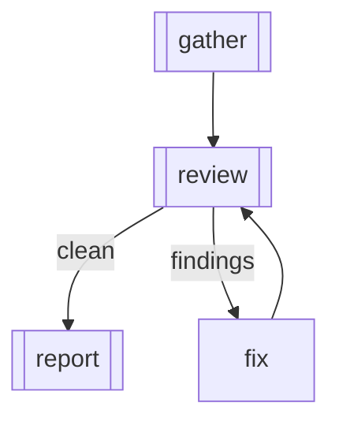

# RFC 0002: nested workflows and child sessions

Status: sections 1 to 12 are **spiked**: calls in the current context
and in children, fresh steps, child settings, kept children and the
judge as a child. Notes in each section say where the build differs
from the first proposal. It covers nested flows and children: what
a nested call records, how invocations are keyed, how failures and
resumes cross levels, pinning, bounds, the record format, fresh steps as
child sessions, child settings, kept children and the judge. Where it
differs from RFC 0001, this RFC is the proposal. Syntax is proposed
with each part and is not settled.

## The principle, applied

Everything a workflow does at run time is a call with arguments and a
result, made in the context it operates in. The same hooks, policy,
recording, replay and fronts handle it as handle any tool call. Nothing
is kept on the side.

| What happens | The call that records it | Whose it is |
|---|---|---|
| an invocation starts | `flow_start` | its key, in the call ID |
| a program step | the step's tool, or `run_script` | the frame's key, in the call ID |
| a call to a workflow | `flow_call` | the calling frame's key, in the call ID |
| a model step in context | `flow_finish`, made by the model | its `run` argument |
| a model step in a child | `flow_call`, which the child answers | the calling frame's key |
| a question | `flow_ask` | the key, in the call ID |
| a verdict | `flow_judge` | its `run` argument |
| an invocation ends | `flow_end` | the key, in the call ID |

A call being a tool call does not make it a model's to make. The program
decides control flow. The gate refuses every `flow_` call and
`run_script` from a model, as it does now.

Nothing in agentturn, agentskill or the session format changes. What
this design uses already exists:

- agentturn: deferral and `ApproveWith`. A fresh child's call is held
  the way `flow_ask` is held now.
- agentturn/session: `Recorder.StartChild` and `ContinueChild`, which
  write a subsession link carrying a host-chosen spawn ID.
- agentsession: `SpawnedSessionID(parent, spawnID)`, which derives the
  child session's ID from the parent's ID and the spawn ID alone.

## 1. Calling a workflow (spiked)

In Go a node sets `Flow`, and `Graph.Link(flows...)` resolves the calls
of a graph and of what it calls, and checks each contract. `Apply`
refuses a graph that calls and is not linked. `workflow.LoadWith(skill,
find)` loads a skill with every workflow it can reach and links them;
`workflow.Load` is that with no other skills to find. A script of a
workflow of another skill than the run's root names its skill in
`ScriptCall.Skill`, and `script.Skills` gives each skill's files.

A program node that names `flow` calls that workflow:

````markdown


## review
```yaml
flow: pr-review
with:
  pr: ${{ inputs.pr }}
  diff: ${{ steps.gather.outputs.diff }}
```
````

- `flow` takes the place of `run` and of `tool`/`args`. A node with
  `flow` has no `outputs`: its data is whatever the callee outputs.
- The shape is `[[ ]]`, because the program makes the call. Mermaid's
  `[[ ]]` is the subroutine shape.
- `flow` names one of two things:
  - **another workflow skill**, by its name (`flow: pr-review`). The host
    finds it the way it finds any skill (`agentskill.Catalog`).
  - **a workflow file in the same skill**, by a path starting `./`
    (`flow: ./flows/triage.md`). The file has the format of a
    `WORKFLOW.md` and is taken from the snapshot the skill was loaded
    from, so the skill's digest already covers it. Its workflow is named
    `<skill>/<path without .md>`, here `pr-review/flows/triage`.
    - Its scripts are paths within the skill, as in the skill's own
      `WORKFLOW.md`.
    - It can be called only from within its skill. A skill's surface is
      its marked workflow.
- Loading a workflow also loads every workflow it can reach. A missing
  or invalid one is a load error that names the chain of calls:
  `take-issue → review → pr-reviw: no such workflow`.
- Workflow names leave call IDs ([section 4](#4-invocations-and-keys)),
  so a name may hold `/`.
- Flows nest to any depth up to the bound in
  [section 7](#7-bounds-across-a-tree). A workflow may call itself,
  directly or through others. When the callee ends, the caller goes on
  from the calling step, by the callee's outcome.

## 2. The contract, checked at load (spiked)

**A workflow's outcomes are its ends.** An edge into an end, written
`a -->|clean| clean((clean))`, ends the workflow with the end's ID as its
outcome. An outcome with no edge ends it with that outcome's own name.
Today an end's ID means nothing, so this gives an existing meaning to
end IDs, and `Format` draws one end per outcome where it now draws a
single `done`. Ends are how a reader already sees the ways out, so they
are where the contract is written.

**A workflow's outputs are by outcome,** as a step's are. Each outcome
declares what its end gives back:

```yaml
---
inputs:
  pr: {type: integer, required: true}
outputs:
  clean:
    summary: ${{ steps.score.outputs.summary }}
  findings:
    findings: ${{ steps.review.outputs.findings }}
    summary: ${{ steps.score.outputs.summary }}
---
```

- Each outcome's outputs are checked on every path into its end, as a
  step's `with` is now. A plain reference must have a value on each such
  path.
- An output's schema is the schema of what it refers to, on each path
  into the end, as the outcome taken there declares it. Paths that
  disagree, or a member that declares no schema, leave the output untyped
  but present.
- The flat form of RFC 0001 is still read: it gives the same outputs for
  every outcome. It is the only form when the workflow has a single
  outcome. A map whose keys are all outcomes of the workflow is read by
  outcome.

**`failed` is an outcome of every call.** A callee that fails gives the
caller the outcome `failed`, with the data `{reason, workflow, step}`.
The caller routes on it like any other outcome. With no edge for
`failed`, the calling step fails instead, and raises its retry question
([section 5](#5-failure-at-each-level)). So an unrouted `failed` is no
way out of the calling workflow: it is not among that workflow's
outcomes, and no outputs are asked for on it. A live trial found the
outputs of the flat form asked for there. An end may be named `failed`:
reaching it ends the invocation `failed` with that outcome, and it
declares no outputs.

**The contract:**

| Part | The caller | Checked at load |
|---|---|---|
| inputs | `with` | every input the callee requires is given on every path into the call, and no name is unknown. A literal holds to its schema. A reference holds to the callee's schema on each path, using the schema the referenced outcome declares there |
| outcomes | the node's `outcomes`, which default to the callee's plus `failed` | the caller's list is the callee's set, with or without `failed`. An edge for any other outcome is an error |
| data | `steps.review.outputs.x` | `x` is an output of the outcome taken on each path that reaches the reference, the same rule as for a step's members. A loop that can call again with another outcome loses the first outcome's outputs |

An output's schema is spiked more simply than the paragraph above says:
it is the schema of what it refers to where every outcome of the
referenced step that declares the member agrees, and untyped otherwise,
not read path by path. Whether a member is present is read path by
path, as for any step.

A value whose schema is not known until it is made, such as the untyped
output of a script, is checked again when the call is made. A value that
breaks the schema then fails the step, as a script that breaks its
schema does now.

## 3. Context (spiked)

- **The default is the current context.** The callee's steps write to the
  caller's transcript. Its `session` model steps read that conversation
  as any step does.
- **`context: fresh`** on a call or on a model step runs the work in a
  child session.
- **Both kinds work at any depth.** Inside a child, the child's own
  context is the current one, so a nested call there runs in the child
  unless it is marked fresh.
- **A child sees what it is given.** That is the inputs its call passes
  in, the instructions its settings give it
  ([section 10](#10-a-childs-own-settings)) and its own tools. It never
  sees the parent's transcript.

## 4. Invocations and keys (spiked)

**Every invocation has a key.** The key is 10 hex digits, drawn when the
invocation starts and recorded in its `flow_start`. Call IDs are built
from the key, the node and the visit:

```
flow_<key>_start
flow_<key>_<node>_v<visit>[-a<attempt>][-retry]
flow_<key>_end
```

The longest is 49 characters. The workflow's name leaves the ID, so the
16-character cut on workflow names and its hash both go away. Ancestry
is never encoded in an ID: the start records it.

**The start names the key, the parent's key and the calling call:**

```json
{"workflow": "pr-review", "digest": "sha256:…", "format": 2,
 "run": "3fa9c2d1e0", "parent": "77b01c4a9e",
 "caller": "flow_77b01c4a9e_review_v1", "depth": 1,
 "inputs": {"pr": 812}}
```

The end records the key as `instance`, as format 1 did, with the
`outcome` reached, the `step` a failed run was at and, for a bound
across the tree, the `limit` it hit.

**Every call, result, model finish, verdict and step message belongs to
exactly one key:**

- The program's calls name the key in their IDs.
- `flow_finish` and `flow_judge` take a required `run`, allowed one
  value, as `step` is now. A finish that names another run is refused,
  and the model is told why. A finish is matched by its run and its
  step, never by the step's name alone.
- Each step message (the opening message, the reminder and "no verdict")
  ends `(run <key>, visit <n>)`, the tag format 1 already wrote, and is
  matched by key and node.
- Any other call a model makes, such as `read` or `grep`, and anything
  it says, belongs to the frame whose model step or judge was current at
  that item. Exactly one frame is current at any item, so replay knows
  which.

**The running frames form one chain,** from the root to the current
frame:

- A start whose parent is the current frame, and whose caller is that
  frame's current call, pushes a frame onto the chain.
- An end pops the frame off.
- A start of any other shape is refused by the gate. Replay reports it,
  and does not guess past it.
- An inner start does not abandon the frame that called it.

**A frame reads only its own record.** Position, visit counts,
references and outputs are each read within one key. A caller learns
what its callee did from its call's result, as it would from any step's.

**An explicit new invocation by a person abandons the whole unfinished
stack.** `flow_end` with status `abandoned` is written for each frame,
innermost first, before the new start. For a fresh child, the child's
end is written in the child's session, and the parent's held call is
refused with the reason `abandoned`.

### The record, in context

A callee's work cannot sit between a call and that call's output:

- agentturn will not go on while a call is unanswered.
- Providers refuse a request that holds an unanswered call.
- A deferral ends the run, so the callee could not run in the same
  transcript meanwhile.

So in a shared context the callee's start names the calling call in
advance, and the call and its result are written when the callee ends:

```
flow_start  flow_3fa9c2d1e0_start   {run: 3fa9…, parent: 77b0…, caller: flow_77b01c4a9e_review_v1, inputs}
  … pr-review's steps, all under 3fa9… …
flow_end    flow_3fa9c2d1e0_end     {run, status: done, outcome: clean, outputs, path}
flow_call   flow_77b01c4a9e_review_v1  {workflow: pr-review, digest, run: 3fa9…, with}
  → {"outcome": "clean", "data": {…}}
```

- The call's ID is known before the call is made, because it is a
  function of the caller's position.
- The call's arguments are resolved from the caller's record, which does
  not move while the callee runs. The gate refuses a `flow_call` whose
  `with` differs from what the callee's start recorded.
- The `flow_call` tool returns the callee's ending, read from the record.
  A callee that failed gives an error, and the calling step fails
  ([section 5](#5-failure-at-each-level)).

### The record, through a child (spiked)

A fresh call goes the way `flow_ask` goes now:

```
parent  flow_call  flow_77b01c4a9e_review_v1  {workflow, digest, run: 3fa9…, with, context: fresh, spawn: 3fa9…}
        decision   hold by policy             (the run ends input_required)
        link       subsession, spawn_id 3fa9c2d1e0
child   agentflow: start pr-review {…}        (developer message: the invocation)
        flow_start … steps … flow_end         (session SpawnedSessionID(parent, "3fa9c2d1e0"))
parent  decision   proceed by policy, with result (or failure) added to the arguments
        output     {"outcome": "clean", "data": {…}}
```

The parent holds the call, the result and the link. The spawn ID is the
child's key, or for a kept child the first visit's key
([section 11](#11-keeping-one-child)), so the child's session is found
from the parent's session alone. The child's start records `parent`,
`caller`, `depth`, `context: fresh` and `path`, the way to the call from
the run nobody called, beside its own definition and closure, so the
child's session reads on its own.

`Drive` does the work. A run that ends `input_required` on a held call
is not returned: the child is opened through the host's opener, given
with `Children`. The child's run is then handled by what it holds:

- not started: prompted with the invocation;
- cut off part way: continued;
- with calls pending: driven on them.

Each child is driven the same way, so its own children are too. When
the child's run has ended, the held call is approved with `result` or
`failure` added to its arguments, and `flow_call` returns that. A child
that waits on a question stops `Drive`, which returns that child's end
and state. `Resume(ctx, g, a, answers)` takes an answer down to the
child that holds the call and drives back up. `Invoke(ctx, g, a,
inputs)` is a person's new invocation over a tree that may wait on
children.

The opener returns the context the child's runs take and the child's
agent: with agentturn/session, the context of `Recorder.ContinueChild`,
or `StartChild` for a spawn not yet linked, and an agent seeded from the
child's session. Its config goes through `Child.Apply`, which gives it
the caller's options. Without an opener, `Apply` refuses a graph with a
fresh step or call, or a step the host lets a judge answer. agentflow
cannot record a child itself, since the root package does not import
agentturn/session.

**Not built: `usage` in the result.** `Drive` could count the child's
usage only for the runs it saw. After a resume the count would be
partial, and the record would hold a wrong number. agentsession's
`DelegatedWork` adds child sessions up by link correctly, so cost is read
from there.

### Reading it back as a tree

`Runs(record, open)` replaces `Instances`, and returns `[]*Instance`.
It returns each invocation with:

- its key, parent, caller, workflow and digest;
- the session, for a child;
- the span of items it covers, its path, status and state;
- its children.

`open` reads a child's session by spawn ID (spiked). A run in a child
is listed with `Fresh` and its `Spawn`, read from its own session. Without
`open`, a child appears with the status its call's result gives. A
child's session read on its own lists its runs as runs nobody called
there, each naming its caller.

## 5. Failure at each level (spiked)

| Event | In the frame where it happens | In each frame above |
|---|---|---|
| a step fails | the retry question, in its own key. `retry` runs it again; `stop`, or nobody to ask, ends the frame `failed` | the call ends with the outcome `failed`. With an edge for it, the caller goes on there. Without one, the calling step has failed and raises its own retry question; `retry` calls the callee again under a new key. Nobody to ask: that frame fails too, with the reason chained (`review: pr-review failed at gather: …`) |
| a visit bound, or a step that repeats itself | a person is asked to grant more (RFC 0003, section 21); `stop`, or nobody to ask, ends the frame `failed` | as for a failed step |
| a bound across the tree (depth, step entries) | a person is asked to grant more, in the frame that would cross it; `stop`, or nobody to ask, ends it `failed` | every frame fails without a retry question, since a retry would cross the bound again |
| abort (context cancelled, `Agent.Abort`) | nothing is written; the frame is still running | the same. A child's run is aborted, and its parent's call stays held |
| a person's new invocation | `abandoned`, innermost first | `abandoned` |
| a pending question | the run ends `input_required` on that frame's `flow_ask` | in context, nothing more. Through a child, the parent is already `input_required` on its held `flow_call` |
| resume | replay gives the chain, and the current frame continues | a held `flow_call` names its child's key. `Drive` reopens the child from the store, continues it, and when it ends answers the parent's call. This recurses through each child |

A failed inner flow never ends the outer one silently. Each level writes
its own end with its own reason. Only a bound across the tree skips the
`failed` edge, as it skips the retry question.

**Questions at depth:**

- `Question` gains `run`, `workflow` and `path`, the root-to-frame list
  of workflow, run and step, so a front can say where the question comes
  from.
- An answer is checked against that frame's pinned definition. The root
  graph, linked, holds them all, so `Graph.Answer` stays.
- A host names a judged step of a called workflow to `Delegate` as
  `<workflow>:<step>`.
- `Drive` returns the end of the run that waits, at any depth, with its
  path, and `Resume` gives the answer to the agent it belongs to.
- A person's new invocation over a held child goes through `Invoke`. It
  abandons the child's runs in the child's session first: the program
  tells the child `agentflow: abandon`, and the child ends its runs and
  starts none. The held call is then refused with `agentflow: abandoned`,
  ahead of the invocation.
- A policy deferral of an ordinary tool call inside a child surfaces the
  same way.
- While a child waits, the parent takes no prompt, since agentturn
  refuses one while a call is pending. A front sends the person's words
  to the child that is waiting on them.

## 6. Pinning definitions (spiked)

- Loading resolves the closure: the root and every workflow it can reach.
  The root's `flow_start` carries `definitions`, each workflow's
  definition and digest by name. The digest recorded for the root covers
  the whole closure: the sorted names, each with its own digest. So
  approving a root approves everything it can call.
- An in-context start carries the callee's name and digest. Its
  definition is read from the root's pins, and a start naming a digest
  that is not pinned is refused.
- A fresh child's start carries its own definition and those it can
  reach, as pinned at the root, so the child's session reads on its own.
  The caller's call names the callee's own digest, which the child's
  start is held to through its closure's.
- **A change to a run in progress:** a change to any workflow in the
  closure makes resuming fail with `ErrChanged`, naming the workflow that
  changed. This holds whether or not the run has reached that workflow
  yet. Running the pinned copy instead is not possible, because the
  record holds definitions but not scripts. Reading back a run is
  unaffected, since it uses the pins.

## 7. Bounds across a tree (spiked)

- **Depth.** The root has depth 0, and each call adds 1, in context or
  fresh. The default bound is 8. It can be set with `max_depth` in the
  root's frontmatter or with the host option `MaxDepth`; the smaller
  wins. A call that would go deeper asks for more depth, and failing on
  it is a tree-wide limit ([section 5](#5-failure-at-each-level)).
- **Steps.** Every step entry, which is a node made current, counting
  attempts, counts once toward the tree's total. A calling step's own
  entry counts as well.
  - In context, replay counts every frame's entries.
  - A fresh call passes what the tree has left as `max_steps` in its
    arguments. The child counts against it, the result of the call
    carries the entries the child's runs made, and the caller adds those.
    The bound and its syntax are in RFC 0003, section 18.

## 8. Record format 2 (spiked)

`RecordFormat` becomes 2. The changes:

- call IDs;
- the `run` argument of `flow_finish` and `flow_judge`;
- the wording of step messages;
- the start's `run`, `parent`, `caller`, `depth`, `definitions`, and for
  a child's run `context` and `path`;
- the end's `outcome`;
- `flow_call`, and `flow_judge` made by the program.

**Older sessions are not read.** The repository is private and no
session needs keeping, so format 1 was dropped rather than carried
beside format 2. A format-1 start fails replay with `ErrChanged` and
"record format 1", and `Runs` reports it in `Problem`. Gone with it:

- parsing of format-1 call IDs;
- finishes and verdicts that name no run;
- untagged step messages;
- the judge that worked in the caller's transcript.

## 9. A fresh model step is a child (spiked)

`context: fresh` on a model step becomes a fresh call of a one-step
workflow made from that step, named `<workflow>:<step>`, with the step's
prompt, tools, outcomes and schemas, reading its `with` as its inputs.
The caller's own digest already covers the step, so the made workflow
is not added to the root's pins. The child's start pins it, so the
child's session reads on its own. Its session reads like any run:
invocation, start, opening message, the model's work, finish, end. The
narrowed view of the parent's transcript is gone, and with it `since`,
`ownInput` and their special cases.

| Concern | As a child |
|---|---|
| inputs | the step's `with`, resolved in the caller and carried by the child's start. The child's instructions show them, as now |
| results | the child's `flow_finish` gives the outcome and data, the child's end records them, and the parent's `flow_call` returns them. The parent routes on them as on any step |
| request hashes | each request of the child's is the child's whole transcript, with no narrowing, so every request keeps a verifiable hash, fold or no fold. Before, a fresh step's request after a fold was unverifiable. Tried offline with folds in both caller and child: every response of both sessions has a hash that rebuilds |
| compaction | the child has its own `Transform`, from the host's opener. The parent's compaction never sees the child's turns. `SummaryFilter` serves both |
| cost | recorded on the child's responses. agentsession's `DelegatedWork` adds child sessions up by link. The result carries no `usage` ([section 4](#the-record-through-a-child-spiked)) |
| cancellation | cancelling the parent's context aborts the child's run and writes nothing. A resume continues the child |
| questions inside | a model step asks nothing, but a policy may hold one of its tool calls. The child's run then ends `input_required` and `Drive` surfaces the hold with its path ([section 5](#5-failure-at-each-level)) |
| resuming | from the store: the held call carries the child's key, and the key is the spawn ID |

**The host's opener**, as built:

```go
type Child struct {
	Run, Spawn     string // the child's key, and the spawn ID of its session
	Caller, Parent string // the call that holds it, and the caller's key
	Workflow       string // a workflow, <workflow>:<step> or <workflow>:<step>:judge
	Step           string // the step a fresh step or a judge works on
	Judge          bool
	Kept           string // a kept child's name (section 11), or empty
	Depth          int
	Path           []Place
	Settings       ChildSettings
}

type ChildSettings struct {
	Dir, Model, Instructions string
	Tools                    []string
}

// Apply makes cfg follow the child's workflow, with the caller's
// options and opts (a History for the child's record, say).
func (c Child) Apply(cfg agentturn.Config, opts ...Option) (agentturn.Config, error)

func Children(open func(ctx context.Context, c Child) (context.Context, *agentturn.Agent, error)) Option
func Models(names ...string) Option
```

The opener returns a context as well as the agent, because the
recorder finds a child's session from the context a run takes. It is
called each time the program works on a child, so it builds a fresh
agent seeded from the child's session, or keeps one in memory.

## 10. A child's own settings (spiked)

These keys are allowed only with `context: fresh`, but for `model`, which
RFC 0003 (section 14) opens to every model step, with `thinking`, and
`dir`, which a script step takes too.

```yaml
context: fresh
dir: services/api              # relative to the workspace root
model: claude-haiku-5-5
tools: [read, grep, edit]
instructions: prompts/api.md   # a file in the skill
```

- **`dir`** is the child's working directory: a literal path, or one
  reference to one (spiked).

  ```yaml
  dir: ${{ steps.setup.outputs.worktree }}
  ```

  - A literal must be relative and clean, with no `..`; this is checked
    at load. A reference is checked at load like any other: it must have
    a value on every path into the step, and where its schema is known
    it must be a string. `latest(...)` is allowed; `optional(...)` is a
    load error, since a step works in one directory.
  - The value is resolved from the record when the step's call is made,
    and the call records it in its arguments, as `dir`. A child is
    opened in the directory its call recorded, so a resume reads it from
    the record and never resolves it again.
  - At call time it must still be a clean relative path below the
    workspace's root. If it is not, or it is not a string, the gate
    refuses the call with the reason, the step fails and its retry
    question follows. No child is opened.
  - Whether the directory exists is checked when the opener makes the
    workspace: `script.Sub` refuses a missing one, one that is not a
    directory or one outside the root, with an error that wraps
    `ErrChildRefused`. An opener error that wraps it is something the
    step got wrong, not the host: the call that waits on the child is
    answered with the error's words, so the step fails and asks to retry,
    a call to a workflow goes on where it routes on `failed`, and a
    judge's look gives no verdict, so the person is asked. Unattended,
    the run fails as for any failed step. No step of the child ran, so
    nothing is added to the caller's count. Setting such a call aside,
    by an override, an invocation or its call's timeout (RFC 0008,
    section 3), answers it the same way and never fails for it. Any other opener error is the host's and comes back
    from `Drive`, the call still held.
  - **A script step takes `dir`** and runs there, through the
    workspace's `Command.Dir`, so a script can work in a worktree an
    earlier script made. The workspace's root does not move:
    `$AGENTFLOW_SKILL_DIR`, `$AGENTFLOW_OUTPUT` and `$AGENTFLOW_PROGRESS`
    are absolute where the workspace has a root on the host, and lead
    from the script's directory where it has none. The script tool checks
    the directory exists before it runs.
  - **A tool step takes no `dir`.** Its tool is the host's, built on the
    host's workspace; a step cannot move it.
  - **A kept child** (section 11) is held to the directory its first
    call recorded. Steps that keep one child with literal dirs are
    checked at load, as before; where a dir comes from data, a later call
    that resolves another directory fails its step, naming both.
  - agentworkspace offers no sub-workspace, so agentflow adds
    `script.Sub(ws, dir)`, a workspace whose root, file system and
    commands are confined to `dir`. A link inside `dir` is followed as
    the parent workspace follows it.
  - The host's opener builds the child's tools on it. The AGENTS.md chain
    for `dir` is the host's to add (`agentsmd.Chain`), as it would be
    for any agent started there.
- **`model`** names the child's model. The opener maps the name to a
  model. A host option `Models(names...)` lets `Apply` check every step's
  model, and the judge's, at load.
- **`tools`** keeps its present meaning. Not built: checking the names
  at `Apply`. A child's tools are the opener's, built for its `dir`, so
  the caller's config cannot say what they will be.
- **`instructions`** is a file in the skill. `workflow.Load` reads it
  from the snapshot into the definition, so the digest covers it, and
  it is added to every request of the child. `Format` writes the file's
  name back.

## 11. Keeping one child (spiked)

```yaml
context: fresh
child: reviewer
```

- Model steps of one invocation that name the same `child` share one
  child session, across visits and across steps. The name is scoped to
  the invocation, so a recursive invocation gets its own.
- The first call starts the child. Its key is the spawn ID, and the
  call's arguments carry `child: reviewer` and `spawn`. Later calls name
  the same spawn and continue the session at its leaf. Replay learns the
  spawn from the first call as it is made, so a child that failed is
  still the one kept.
- Each visit is a frame of its own in the child: its own key, start, end
  and opening message. So the child reads as a sequence of runs, and its
  model sees its own earlier visits.
- At load, steps that share a child must agree on `dir`, `model` and
  `instructions`. Their `tools` may differ, since each request offers
  its own step's tools. A `dir` taken from data is held instead, when
  the call is made, to the directory the child started in (section 10).
- A fresh call to a workflow does not take `child`, because a workflow
  run is a session of its own. That can be opened up if a workflow needs
  it.

## 12. The judge becomes a child (spiked)

Approved, and built.

Before, a judge's request was the parent's transcript narrowed to the
node's opening message. This caused four problems:

- what it looks at is hidden from later steps by spans of omissions
  (`unseen`);
- its request after a fold is unverifiable;
- a summarizer reads its look at files as the assistant's;
- a front shows its turn as it happens.

As a child:

- The program makes `flow_judge` in the parent, ID
  `flow_<key>_<step>_v<n>-judge`, and the call is held while the judge
  runs.
- The judge runs `<workflow>:<step>:judge`, one model step whose
  instructions hold the question and the criteria, whose tools are the
  judge's, and which ends with the judge's model calling `flow_judge`
  with its run, step, outcome and reason.
- The judge's session holds its look at files and its verdict call.
- The parent's call is approved with the verdict, and returns it.
- A judge that stops twice, or gives two verdicts it may not give, comes
  to no verdict (`Verdict.None`). Under `shadow` the held answer's step
  then finishes with no advice. Under `advise` and `decide` the question
  goes to the person with the hand-back marked as none. Before, a judge
  that stalled was `ErrStalled`.
- The child is linked as any spawned child is, by a subsession link.
  agentsession's `judged_by` relation is not used.

Under `shadow`, only that one call and its result are left out of the
working model's requests, not a span of the transcript, and `unseen` goes
away. The judge's input is unchanged: the question, the `with` values,
the criteria and its tools.

Under `advise` and `decide` the verdict is not blind, and the working
model reads it, its reason included, as it reads a person's. So a judge
is told to give its reason in its own words about the work, and not to
quote, name or refer to what it was told to weigh. A live trial found a
judge's reason quoting a reference token from its criteria into the
working model's next request; with the instruction, six of six were
clean. It is an instruction, not a guarantee: a reason can still carry
what the criteria say in other words.

The trials recorded in RFC 0001 were made with the judge inline, and
have not been run again with it as a child.

## The rules, held

- **Position** is a pure function of the definitions and the record. A
  child's position is a function of its own session, and a parent's of
  its own session plus its calls' results.
- **Resuming** needs the store and the definitions. A child is found by
  `SpawnedSessionID(parent, key)`.
- **Control flow** depends on outcomes recorded in results and on
  nothing else.
- **Unknown keys** stay load errors. Each new key is checked at load
  where it can be (contract, closure, `dir`, kept-child agreement,
  models and tools where the host names them).
- **The working model** never sees a definition, criteria or a blind
  judge. Every `flow_start` stays out of its requests, a child holds no
  definition the child's model is sent, and a judge child is the judge's
  own.
- **The loop** learns nothing: children are agents a host makes, and the
  hold is an ordinary deferral.
