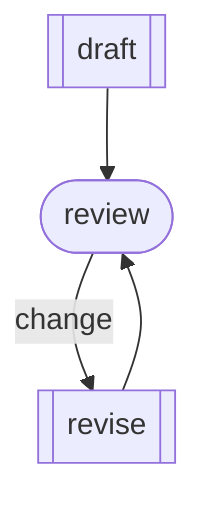

# RFC 0003: step settings and limits

Status: **spiked**. Every section is built and tested in this
repository, offline with scripted models. None has run with a real
model. It builds on RFC 0001 and RFC 0002, and where they disagree this
RFC is the newer. Syntax is proposed with each part and is not settled.

It covers:

- a step's timeout;
- a step's model and thinking;
- a policy on what a step's tools may touch;
- a bound on the steps a tree of runs may enter;
- stopping a loop whose script repeats itself;
- a model reporting that it is stuck;
- asking a person for more when a bound is reached;
- a loop a person drives, which no visit bound stops.

Every rule of the earlier RFCs holds. Each of these is a call with
arguments and a result in the context it acts in. Position is read from
the definitions and the record. The clock matters only through a result
the record holds. Nothing in agentturn, agentskill or the session format
changed.

## 13. Timeouts

````markdown
## lint
```yaml
run: scripts/lint.sh
timeout: 90s
```

## fix
```yaml
timeout: 10m
```
````

- `timeout` is a duration from 1ns up to 24h. It may be set on script,
  tool and model steps. On a person step it is the question's timeout,
  which takes an outcome rather than failing (RFC 0004, section 26). On
  a call it bounds the run it calls (RFC 0008, section 3). On a judge it
  is a load error. A workflow's frontmatter `timeout` is the default of
  its script, tool and model steps (RFC 0008, section 3).
- **A script or tool step** runs with a context that ends at its
  timeout. The host's tools are wrapped in `Apply` (`agenttool.Wrap`,
  which keeps every property a tool declares). A call cut off there
  returns `agentflow: step "lint" timed out after 1m30s`. That error is
  the call's recorded output, so the step has failed, and the person is
  asked whether to retry it, as with any failed step. A tool that ignores
  its context is not stopped.
- **A model step's deadline is a recorded result.** Before the model
  works on an attempt, the program calls `flow_clock` with
  `{run, step, timeout}` (ID `…_v<n>-clock`). Its result,
  `{"deadline": "<RFC 3339>"}`, is what the attempt is held to. Replay
  reads the deadline from that result and never from the clock.
- **Reaching the deadline:**
  - The model's stream is cut off at the deadline. It ends in
    `ErrStepTimeout`, which agentturn does not retry, and `Drive`
    continues the run.
  - A tool the model calls during the step is cut off at the same
    deadline.
  - The next turn is the program's. It calls `flow_clock` again with
    `expired` (ID `…-timeout`). The error that call returns is the
    step's failure.
  - The program then asks whether to retry. A retry is a new attempt
    with a deadline of its own, and its opening message names the
    attempt: `(run <key>, visit <n>, attempt <m>)`.
  - The clock decides when the program takes that turn, but what
    happened is the call and its result.
- **Unattended,** a model step that sets no timeout gets
  `DefaultUnattendedTimeout` (30 minutes). `UnattendedTimeout(d)`
  changes it, and 0 turns it off. A judge's look in a child is such a
  step.
- The model is told its time in its instructions.
- A fresh step's timeout bounds its child's model step.

## 14. Model and thinking

````markdown
---
model: claude-sonnet-5-5
thinking: low
---
## review
```yaml
model: claude-haiku-5-5
thinking: high
```
````

- `model` and `thinking` may be set on any model step. The workflow's
  frontmatter gives the defaults for its own steps. Otherwise the host's
  config decides. A callee uses its own defaults, not its caller's.
- `thinking` is one of `none`, `minimal`, `low`, `medium`, `high`,
  `xhigh` and `max`. `max` is openresponses' extension, sent as `xhigh`
  plus the extension member.
- Both are set on the request in `BeforeModelCall`, before the request
  is recorded. So the record and the request hash hold them, and the
  host's model is asked for that name.
- `Models(...)` checks every step's model, and every workflow's default,
  at `Apply`.
- A fresh step's child is given them: `ChildSettings.Model` and
  `Thinking`, and its derived workflow's step requests them too.
- `model` is still allowed on a fresh call, as the child's model.
- **Another model runs in a child.** A model step whose `model` differs
  from its workflow's frontmatter `model`, or that names one when the
  frontmatter names none, defaults to `context: fresh`. `context:
  session` keeps it in the current context.
  - Why: the other model would read a conversation another model wrote,
    without that model's reasoning, which a request leaves out for any
    other model, and would take the earlier turns for its own.
  - It is decided from the definition alone, at load, never from the
    host's config, so position stays a function of the definitions and
    the record. A host serving the frontmatter's model under another name
    changes nothing.
  - The workflow made for a fresh step takes the step's model as its own
    default, so the step does not open a child of its own child.

## 17. Tool policy

````markdown
## build
```yaml
tools: [read, edit, bash]
policy:
  allow: [read, edit(src/*), bash(go test:*)]
  deny:
    - read(.env)
    - {rule: edit(src/gen/*), note: generated; run go generate}
```
````

- **The rules are agentpolicy's**, in its grammar: a tool name, and in
  parentheses a specifier the tool's matcher reads. agentflow keeps no
  path or command matching of its own.
  - `deny` refuses the calls its rules match.
  - `allow`, if set, refuses every call none of its rules matches. An
    empty `allow` is a load error, since it would allow nothing.
  - Deny is read before allow, as agentpolicy reads them, and a carve-out
    (`!`) works as it does there.
  - A rule may carry a `note`, which the refusal and the step's
    instructions give after it.
- **A policy only narrows.** agentflow asks each engine what it would
  decide (`Engine.Would`), which remembers nothing and tells no observer,
  and acts only on a refusal. A call every policy lets through goes on
  to the host's own `BeforeToolCall`, which may still refuse or ask. So
  a workflow file cannot give itself what the host does not, which keeps
  RFC 0001's two keys. There is no `ask`: a workflow's question about a
  tool call would be a second way to ask a person, with no step to hold
  it.
- **Where it is set:**
  - on a model step;
  - on a call (`flow:`), where it limits every model step and judge of
    the runs it calls, at any depth, in context or in children;
  - on a judge (`judge.policy`).
  Every policy in force applies, so the limits only add up.
- **What a tool's arguments touch is the host's to say,** as agentpolicy
  has it: `PolicyMatchers(func(dir string) map[string]agentpolicy.ToolMatcher,
  opts...)` gives a matcher, and where one call is several subjects a
  splitter, for each tool whose rules take a specifier. Options such as
  `WithAliases` go to every engine.
  - **Paths are below the workspace's root, in a child too.** The host is
    asked for the matchers of each working directory the steps run in,
    `""` for the root and a child's `dir`. `InDir(dir, field)` is
    `GlobMatcher` over a field read as a clean path below `dir`, so
    `edit(secret/*)` set above a child at `secret` refuses its edit of
    `key`.
  - A tool with no splitter is one subject per call. A shell's
    substitutions and compounds are the host's splitter's to read, since
    agentpolicy holds no shell parser; one that cannot read a command
    fails, and agentpolicy refuses the call.
  - A tool that claims facts (`agenttool.Factual`) is read by its claims,
    as agentpolicy reads them.
- **Checked at load:**
  - each rule parses, one to an entry;
  - a rule on a step or a judge names a tool it offers (a rule on a call
    covers steps whose tools are their own);
  - `Apply` builds every policy's engine with the host's matchers, so a
    specifier for a tool with no matcher is refused there
    (`agentpolicy.ErrNoMatcher`), and so is a tool-name glob agentpolicy
    does not honour.
- **Before it acts, the model is told its limits**, in its step's
  instructions: each policy's rules as agentpolicy writes them
  (`Rule.String()`), each with its note, and which step or call set it.
- **A refusal is the gate's block, and names the rule** in agentpolicy's
  words, after where it was set: `agentflow: step "build" refuses this
  call: the policy of step "build" of release: denied by
  edit(src/gen/*): generated; run go generate`, or `…: no rule allows
  bash: denied by default`. The model reads it and can go on.
- **Children** take the policies of the calls and steps they are nested
  in (`Child` carries them), and add their own step's policy. This covers
  fresh steps, fresh calls, kept children and judges. A child's engines
  are built for its `dir`.
- **What it is not:** a sandbox. It decides on arguments and claims, and
  a tool that does more than it says is not stopped.

## 18. Steps across a tree

```yaml
---
max_steps: 120
---
```

- Every step entered counts once toward the tree's total, retries and
  calls included. This applies across every run of the tree, in context
  and in children. The default is `DefaultMaxSteps` (200).
  `max_steps` in the root's frontmatter or the host's `MaxSteps(n)`
  lowers it, and the smaller wins. The root's start records the bound.
- **A child is given what the tree has left.** A fresh call, a fresh
  step and a judge's look each pass `max_steps` in their `flow_call` or
  `flow_judge` arguments; the gate holds it to the record. The child's
  start records it as its own bound, 0 included. When the child ends, the
  result its caller's call returns carries `entries`, the steps the
  child's runs entered, and `granted`, what a person granted there. The
  caller's replay adds both.
- **Whatever came of the child, what it spent counts.** The held call is
  let go with `entries` and `granted` in its arguments however the child
  ended, and the call's output carries them:
  - a result carries them beside its outcome;
  - a failure is the output `{"failure": "<reason>", "entries": n,
    "granted": m}`, which is no result, so the step has failed and asks
    to be retried, and its steps are added;
  - a judge's verdict carries them, so the judge's look counts toward
    the tree as its step.
- Reaching the bound is a bound across the tree: see section 21.

## 19. A loop that repeats itself

- A program step, a script or a tool, that gives the same outcome and
  the same data `RepeatLimit` (3) times in a row reaches the bound
  `repeat`.
  - "In a row" counts that step's own results, with other steps between
    them. This is a loop where a fix and a check go round and the check
    finds the same thing each time.
  - Calls to workflows are not counted, since what they return is the
    callee's.
- It is raised as the loop goes on, at the next step entered, and asked
  about there (section 21). A grant of `n` allows `n` more repeats.
- It is not a bound across the tree: a failed run's caller may route on
  `failed` or retry.
- **A result with no data is not counted.** It says nothing to compare:
  a poll that answers only "not yet", or a check that prints only `fail`.
  Only the visit bound holds such a loop. A script that reports what it
  found is held to the rule.

## 20. A model that is stuck


- Every model step, except a judge's, offers `flow_stuck` with
  `{run, step, reason}`, and its instructions say so.
- The result is the step's outcome `stuck`, with the data `{reason}`.
  `${{ steps.work.outputs.reason }}` is readable after it.
- `stuck` is reserved:
  - No step declares it among its outcomes or outputs.
  - A model step routes on it by drawing an edge or an end for it.
  - With neither, it is a failed step (`the model reported it is stuck:
    <reason>`). That raises the retry question, and a retry opens the
    step again.
- `flow_finish` with the outcome `stuck` is refused, and the model is
  told to call `flow_stuck`.
- In a fresh step's child, the child ends with the outcome `stuck`, and
  the caller routes on it or fails the step.

## 21. Asking for more at a bound

- **Which bounds:**
  - visits (`max_visits`, or the loop default);
  - depth;
  - the tree's steps;
  - a repeating step.
- **The question:** reaching a bound raises a `flow_ask` (ID
  `…_v<n>[-a<m>]-limit<k>`) with:
  - `limit` set to the bound's name;
  - the outcomes `grant` and `stop`;
  - a form for `grant`, `{amount}`, a whole number from 1 to 999;
  - the question saying what was reached, and where.
- **Who answers,** in the usual order:
  1. the host's rules (`Reply`);
  2. a person;
  3. unattended, with no rule that answers, nobody: the run ends
     `failed` with the bound's error (`ErrVisits`, `ErrDepth`, `ErrSteps`
     or `ErrRepeat`), as before.
- **The grant is read back from the record.** A grant of `n`:
  - for visits, allows that step `n` more visits;
  - for depth, allows `n` more levels below that run;
  - for steps, allows the tree `n` more steps;
  - for a repeat, allows `n` more repeats.
- **After a grant,** the next bound reached is asked about in turn.
  `stop` fails the run on that bound.
- **Across a tree:** depth and steps are the tree's bounds. A run that
  stops on one fails every run it is nested in, which neither retries it
  nor routes on `failed`. Visits and repeats are the run's own bounds.
- **Why a bound asks rather than fails,** where a person can answer: a
  bound is a guess made before the run, and the person watching knows
  whether this loop is getting somewhere; failing would throw the run
  away to learn what one answer could say. Unattended nothing changes. A
  host that wants a bound to fail at once answers `stop` with a `Reply`
  rule on `Question.Limit`, so the choice is the host's and is recorded
  `by: rules`.
- **Timeouts are not asked about here:** a step that ran past its
  timeout has failed, and the retry question already asks.

## 22. A loop a person drives

````markdown


## review
```yaml
outcomes: [change, done]
max_visits: person
```
Good?

## revise
```yaml
run: scripts/revise.sh
max_visits: person
```
````

A visit bound stops a loop that runs by itself and gets nowhere. A loop
that waits on a person at every pass cannot run away, and asking that
person, at the sixth pass, whether to allow more is noise while they are
still at work.

- **Paced.** A visit of a `max_visits: person` step is paced when, since
  that step's last visit in the same run, a person step of the run was
  answered by a person: an answer whose `by` is empty. Answers by the
  host's rules, a judge that decides, the `unattended` default or a
  timeout do not pace, so none of those can loop without a bound, and a
  judge's `max_returns` keeps its meaning. A person's answer under
  `shadow` or `advise`, or one a judge handed back, paces. A step's first
  visit is never paced.
- **No bound on a paced visit.** Paced visits are not held to the step's
  visit bound. Every other visit is, and that bound is
  `DefaultLoopVisits`. The visit number in call IDs still counts every
  visit; `State.Paced` says how many of them a person paced. A bound
  that is reached says how many paced visits went free, and asks for
  more as section 21 says.
- **No steps of the tree either.** A paced visit is not counted toward
  the tree's steps (section 18): `State.Entries`, and the `entries` a
  child's result carries to its caller, leave it out. Only that entry is
  exempt. A retry of the step, an operator's override, and every visit
  of a step that is not `max_visits: person` count as before. A run's
  summary still counts every step that ran.
- **Unaffected:** the repeat rule (section 19) and timeouts.
- **Read from the record.** Whether a visit was paced is read from the
  steps the run has finished, so it is a function of the definitions and
  the record, after a resume as before it, in a called run and in a
  child, each in its own run.
- **Checked at load, from the graph alone:**
  - the step is on a loop;
  - every cycle through it passes a person step. A person step passes
    its own. An error names a cycle that passes none, such as
    `fix → check → fix`;
  - `max_visits` is a number or `person`, not both;
  - a step on a loop through a `max_visits: person` step, with no
    `max_visits` of its own, would stop that loop at the default, so it
    is an error: it says `person` too, or a number.
- **Only this run's person steps.** A person asked inside a workflow a
  step calls does not pace the caller's loop, since the caller reads
  only its call's result.
- In Go, `Node.PersonPaced` is `max_visits: person`, with `MaxVisits` 0.

## Open questions

- A kept child's later runs each pass what the tree has left. A grant in
  one counts for the caller too, but is not passed back into the child's
  next run except through that count.
- A model step's deadline cuts only its stream and its tools' calls. A
  turn whose stream has just finished runs its tool calls under the
  deadline, and the program records the timeout on the next turn.
