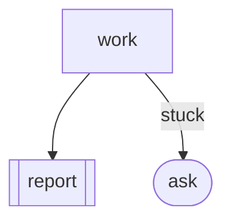

# RFC 0003: step settings and limits

Status: **spiked**. Every section is built and tested in this
repository, offline with scripted models. None has run with a real
model. It builds on RFC 0001 and RFC 0002, and where they disagree this
RFC is the newer. Syntax is proposed with each part and is not settled.

It covers:

- a step's timeout;
- a step's model and thinking;
- a policy on what a step's tools may touch;
- a bound on the steps a tree of runs may enter;
- stopping a loop whose script repeats itself;
- a model reporting that it is stuck;
- asking a person for more when a bound is reached.

Every rule of the earlier RFCs holds. Each of these is a call with
arguments and a result in the context it acts in. Position is read from
the definitions and the record. The clock matters only through a result
the record holds. Nothing in agentturn, agentskill or the session format
changed.

## 13. Timeouts

````markdown
## lint
```yaml
run: scripts/lint.sh
timeout: 90s
```

## fix
```yaml
timeout: 10m
```
````

- `timeout` is a duration from 1ns up to 24h. It may be set on script,
  tool and model steps. On a person step, a call or a judge it is a load
  error.
- **A script or tool step** runs with a context that ends at its
  timeout. The host's tools are wrapped in `Apply` (`agenttool.Wrap`,
  which keeps every property a tool declares). A call cut off there
  returns `agentflow: step "lint" timed out after 1m30s`. That error is
  the call's recorded output, so the step has failed, and the person is
  asked whether to retry it, as with any failed step. A tool that ignores
  its context is not stopped.
- **A model step's deadline is a recorded result.** Before the model
  works on an attempt, the program calls `flow_clock` with
  `{run, step, timeout}` (ID `…_v<n>-clock`). Its result,
  `{"deadline": "<RFC 3339>"}`, is what the attempt is held to. Replay
  reads the deadline from that result and never from the clock.
- **Reaching the deadline:**
  - The model's stream is cut off at the deadline. It ends in
    `ErrStepTimeout`, which agentturn does not retry, and `Drive`
    continues the run.
  - A tool the model calls during the step is cut off at the same
    deadline.
  - The next turn is the program's. It calls `flow_clock` again with
    `expired` (ID `…-timeout`). The error that call returns is the
    step's failure.
  - The program then asks whether to retry. A retry is a new attempt
    with a deadline of its own, and its opening message names the
    attempt: `(run <key>, visit <n>, attempt <m>)`.
  - The clock decides when the program takes that turn, but what
    happened is the call and its result.
- **Unattended,** a model step that sets no timeout gets
  `DefaultUnattendedTimeout` (30 minutes). `UnattendedTimeout(d)`
  changes it, and 0 turns it off. A judge's look in a child is such a
  step.
- The model is told its time in its instructions.
- A fresh step's timeout bounds its child's model step.

## 14. Model and thinking

````markdown
---
model: claude-sonnet-5-5
thinking: low
---
## review
```yaml
model: claude-haiku-5-5
thinking: high
```
````

- `model` and `thinking` may be set on any model step. The workflow's
  frontmatter gives the defaults for its own steps. Otherwise the host's
  config decides. A callee uses its own defaults, not its caller's.
- `thinking` is one of `none`, `minimal`, `low`, `medium`, `high`,
  `xhigh` and `max`. `max` is openresponses' extension, sent as `xhigh`
  plus the extension member.
- Both are set on the request in `BeforeModelCall`, before the request
  is recorded. So the record and the request hash hold them, and the
  host's model is asked for that name.
- `Models(...)` checks every step's model, and every workflow's default,
  at `Apply`.
- A fresh step's child is given them: `ChildSettings.Model` and
  `Thinking`, and its derived workflow's step requests them too.
- `model` is still allowed on a fresh call, as the child's model.

## 17. Tool policy

````markdown
## build
```yaml
tools: [read, edit, bash]
policy:
  write: [src/**, docs/**]     # only these
  no_write: [src/gen/**]
  no_read: [.env, secrets/**]  # nor written
  bash: [go test, go build]    # only commands with these leading words
  no_bash: [go test -exec]
```
````

- **Where it is set:**
  - on a model step;
  - on a call (`flow:`), where it limits every model step and judge of
    the runs it calls, at any depth, in context or in children;
  - on a judge (`judge.policy`).
  Every policy in force applies, so the limits only add up.
- **Paths:**
  - A path is a slash path below the workspace root, without `..`.
  - In patterns, `*` matches any part of one name and `**` any number of
    names.
  - A child's paths are read below its `dir`.
  - An absolute path, or one that leaves the root, is refused under any
    policy.
  - A write is also held to `no_read`, since a write can show what it
    replaced.
- **Commands** are split at `&&`, `||`, `;`, `|`, `&` and newlines. Each
  part is held to the rules by its leading words. Under `bash`, a
  command holding a substitution (`` ` ``, `$(`, `<(`, `>(`) is refused,
  because the rule cannot see what the substitution runs.
- **What a tool touches is the host's to say.** agentflow does not depend
  on agentpolicy, so it builds on agenttool:
  - `ToolSubjects` names, by tool, which top-level arguments are paths
    read, paths written or commands run. A tool named with none touches
    nothing.
  - A tool that claims facts (`agenttool.Factual`) is held to the calls
    it says the call amounts to, each by the subjects of the tool it
    names.
  - Facts the host does not trust (`Hint`) are held beside the call
    itself.
  - Under a policy, a tool that is neither named nor factual cannot be
    read. `Apply` refuses a step whose tools include one, and a call to
    one is refused.
- **Before it acts, the model is told its limits**, in its step's
  instructions: each policy, and which step or call set it.
- **A refusal is the gate's block, and names the rule.** For example:
  `agentflow: step "build" refuses this call: write "src/gen/a.go":
  no_write "src/gen/**" of step "build" of release`. The model reads it
  and can go on.
- **Children** take the policies of the calls and steps they are nested
  in (`Child` carries them), and add their own step's policy. This covers
  fresh steps, fresh calls, kept children and judges.
- **What it is not:** a sandbox. It decides on arguments and claims, and
  a tool that does more than it says is not stopped.

## 18. Steps across a tree

```yaml
---
max_steps: 120
---
```

- Every step entered counts once toward the tree's total, retries and
  calls included. This applies across every run of the tree, in context
  and in children. The default is `DefaultMaxSteps` (200).
  `max_steps` in the root's frontmatter or the host's `MaxSteps(n)`
  lowers it, and the smaller wins. The root's start records the bound.
- **A child is given what the tree has left.** A fresh call, a fresh
  step and a judge's look each pass `max_steps` in their `flow_call` or
  `flow_judge` arguments; the gate holds it to the record. The child's
  start records it as its own bound, 0 included. When the child ends, the
  result its caller's call returns carries `entries`, the steps the
  child's runs entered, and `granted`, what a person granted there. The
  caller's replay adds both.
- A child that fails has no result to carry them, only its error, so its
  steps are not added to the caller's count.
- Reaching the bound is a bound across the tree: see section 21.

## 19. A loop that repeats itself

- A program step, a script or a tool, that gives the same outcome and
  the same data `RepeatLimit` (3) times in a row reaches the bound
  `repeat`.
  - "In a row" counts that step's own results, with other steps between
    them. This is a loop where a fix and a check go round and the check
    finds the same thing each time.
  - Calls to workflows are not counted, since what they return is the
    callee's.
- It is raised as the loop goes on, at the next step entered, and asked
  about there (section 21). A grant of `n` allows `n` more repeats.
- It is not a bound across the tree: a failed run's caller may route on
  `failed` or retry.
- A script that always prints the same `ok` on a loop also reaches it.
  To vary, a script should report what it found.

## 20. A model that is stuck



- Every model step, except a judge's, offers `flow_stuck` with
  `{run, step, reason}`, and its instructions say so.
- The result is the step's outcome `stuck`, with the data `{reason}`.
  `${{ steps.work.outputs.reason }}` is readable after it.
- `stuck` is reserved:
  - No step declares it among its outcomes or outputs.
  - A model step routes on it by drawing an edge or an end for it.
  - With neither, it is a failed step (`the model reported it is stuck:
    <reason>`). That raises the retry question, and a retry opens the
    step again.
- `flow_finish` with the outcome `stuck` is refused, and the model is
  told to call `flow_stuck`.
- In a fresh step's child, the child ends with the outcome `stuck`, and
  the caller routes on it or fails the step.

## 21. Asking for more at a bound

- **Which bounds:**
  - visits (`max_visits`, or the loop default);
  - depth;
  - the tree's steps;
  - a repeating step.
- **The question:** reaching a bound raises a `flow_ask` (ID
  `…_v<n>[-a<m>]-limit<k>`) with:
  - `limit` set to the bound's name;
  - the outcomes `grant` and `stop`;
  - a form for `grant`, `{amount}`, a whole number from 1 to 999;
  - the question saying what was reached, and where.
- **Who answers,** in the usual order:
  1. the host's rules (`Reply`);
  2. a person;
  3. unattended, with no rule that answers, nobody: the run ends
     `failed` with the bound's error (`ErrVisits`, `ErrDepth`, `ErrSteps`
     or `ErrRepeat`), as before.
- **The grant is read back from the record.** A grant of `n`:
  - for visits, allows that step `n` more visits;
  - for depth, allows `n` more levels below that run;
  - for steps, allows the tree `n` more steps;
  - for a repeat, allows `n` more repeats.
- **After a grant,** the next bound reached is asked about in turn.
  `stop` fails the run on that bound.
- **Across a tree:** depth and steps are the tree's bounds. A run that
  stops on one fails every run it is nested in, which neither retries it
  nor routes on `failed`. Visits and repeats are the run's own bounds.
- **Timeouts are not asked about here:** a step that ran past its
  timeout has failed, and the retry question already asks.

## Open questions

- A kept child's later runs each pass what the tree has left. A grant in
  one counts for the caller too, but is not passed back into the child's
  next run except through that count.
- Item 22, letting a loop paced by a person run without the visit bound,
  is not built. The grant is the nearest thing to it.
- A model step's deadline cuts only its stream and its tools' calls. A
  turn whose stream has just finished runs its tool calls under the
  deadline, and the program records the timeout on the next turn.
