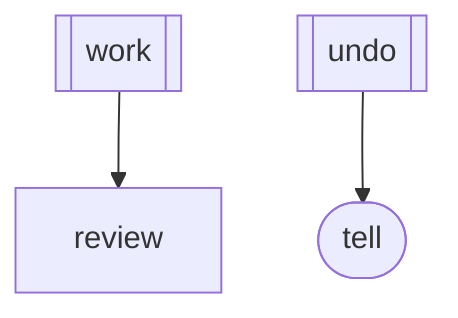

# RFC 0006: documents, cleanup, overrides and summaries

Status: **spiked**, section by section as each is built, offline with
scripted models. It builds on RFCs 0001 to 0005, and where they disagree
this RFC is the newer. Syntax is proposed with each part and is not
settled.

It covers:

- **29.** named markdown documents a model step reads and edits;
- **30.** a cleanup path that runs when a run is abandoned;
- **31.** operator overrides: retry, jump with a note, abandon;
- **32.** a summary written when a run ends;
- **34.** files given to a model step as context.
- **35.** a tool step's arguments, checked at load against its tool.

Every rule of the earlier RFCs holds. Nothing in agentturn, agentskill or
the session format changed.

## 29. Documents

A workflow declares its documents in its frontmatter. Each starts empty,
from a file of the skill, or as one of the workflow's inputs:

```yaml
---
inputs:
  brief: {type: string}
documents:
  plan: {from: templates/plan.md}
  brief: {input: brief}
  notes:
---
```

A step says which it works with:

````markdown
## draft
```yaml
documents:
  read: [brief, notes]
  edit: [plan]
```
Draft the plan.

## load
```yaml
run: scripts/load.sh
documents:
  write: {notes: text}
```
````

- **A model step** lists what it may `read`, and what it may `edit`, which
  includes reading. It is given `flow_doc_read` and, with something to
  edit, `flow_doc_write`. Each takes the step's run and name, as
  `flow_finish` does, and a document name the request's schema holds to
  the step's list. A write carries the document's whole new text.
- **A script or tool step** may `write` documents from members of its
  result's data, by document. A member that is not text fails the step.
- **Program and person steps** read a document's text with
  `${{ documents.<name> }}`, a reference like any other. A document always
  has a text, empty at first, so the reference is certain everywhere. For
  `latest`, a write is newer than the steps finished before it.
- **A judge** reads no documents. A question shows one by naming it in
  `with`.

**A document's text is a pure function of the record.** Its first text
is in the definition, which the run's start pins: loading reads a `from`
file into it, so the digest covers it. After that, each change is a
call's result that holds the whole text: the model's write, or the
program step's result. A read's result holds the text too, so what the
model was shown is in the record. Replay keeps the text by run, and a
frame reads only its own documents.

**Into a call, and back.** A workflow called in context gets a document's
text as an input through `with`, and may start a document of its own from
it (`input:`). It gives text back as an output, which the caller writes
from its result. A fresh model step's call passes the texts of the
documents the step reads into its child, the child's start records them,
and the child's model reads and writes them by calls in its own session.
The child's result carries back the texts of those the step edits, which
the caller takes as its documents. The gate holds the passed texts to
what the caller's record says.

**Compaction** loses no text: the text is read from the record, never
from what a model was sent. A model whose earlier read was folded away
reads again.

**Policy** does not reach documents, which are not files and which no
host tool touches. The step's `read` and `edit` lists are its limits, the
step's instructions state them, and a call outside them is refused with
the list it broke.

**Bounds.** A document's text is at most 1 MiB, its starting text
included; a longer write is refused, never cut.

Checked at load, with the name that was meant: an undeclared document in
a list, a `write` or a reference; `read` or `edit` on anything but a
model step, and `write` on anything but a script or tool step; a `from`
that is not a clean path in the skill, or not in it; an `input` that is
not an input of the workflow, or not text; and a written member that no
outcome declares, or that is not text.

## 30. Cleanup on abort

A workflow may name, in its frontmatter, the step a cleanup path starts
at:

````markdown
---
on_abort: undo
---

````

The path is the steps reachable from `on_abort`. It runs when the run is
**abandoned**, before the run's end is written: by a person's new
invocation, by `agentflow: abandon` from the run that called a child, or
by an operator's abandon ([section 31](#31-operator-overrides)). A
cancelled context writes nothing, so it abandons nothing and runs no
cleanup: the run is still under way, and resumes.

**It can never prevent the abort.**

- Its steps are script, tool and person steps only. It calls no
  workflow, has no model step and no judge, and has no loop. A cleanup is
  bounded by its length, so no bound is checked on it, and it never asks
  for more allowance.
- Nothing on the workflow's own path reaches it, and it reaches nothing
  on that path. Where it ends, the cleanup is over; its ends are no
  outcomes of the workflow.
- A cleanup step that fails is not asked about: the cleanup ends there.
- Whatever the cleanup comes to, the end is written next: `abandoned`,
  with `cleanup` saying `done`, `failed at <step>: <why>`, or
  `cut short: abandoned again`.

**Across a stack, innermost first.** An abandon reaches every run under
way (or, from an operator, the runs out to the one it names). The
innermost runs its cleanup under its own key and writes its end; then the
run that called it does the same; and so on out. Only then does the run
asked for start. A run that had already failed or finished writes its end
as it stands, with no cleanup.

**Through children.** A run in a child session is abandoned in its own
session, as before: its caller's held call is refused, and the child is
told `agentflow: abandon`. The child's runs clean up there, innermost
first. A cleanup question in a child is not put to anybody: the person
is in the session the abandon came from, so the question is refused, the
child is told again, and the cleanup ends there.

**A person step in cleanup.**

- **Attended:** it is asked and waits, like any question, and the run's
  end waits with it. A person who wants out answers it, or abandons
  again: the host refuses the pending question first, with agentflow's
  own words (`agentflow: abandoned`), which replay reads as the cleanup
  cut short, not failed: the end says `cut short: abandoned again`.
- **Unattended:** it takes its `unattended` outcome. Without one, the
  question cannot be answered, which fails the step, which ends the
  cleanup.

A cleanup step's `with` reads only what is certain wherever a run may be
abandoned: the inputs and the documents. A step of the workflow's path is
read with `optional` or `latest`, since it may not have run.

Checked at load: `on_abort` names a step (with the name that was meant);
no step of the cleanup is on the workflow's path; no cleanup step is a
model step, a call or a judged question; and the cleanup has no loop.

**Record.** The cleanup's calls are under the abandoned run's key, after
the invocation, so `Runs` reads a run's span as reaching past an
invocation to its end; the next run's span starts at its own start.

## 31. Operator overrides

An operator can change where a run stands in three ways:

| Action | What it does |
|---|---|
| `retry` | runs the current step of the run again, as a new attempt |
| `jump` | goes to the step it names, as a new visit, with a note |
| `abandon` | abandons the run and every run it called, innermost first, each with its cleanup ([section 30](#30-cleanup-on-abort)) |

```go
end, st, err := agentflow.OverrideRun(ctx, g, agent, agentflow.Override{
	Run: "3fa9c2d1e0", Action: agentflow.OverrideJump, Step: "fix",
	Note: "Fix only the null check; the rest is fine.",
})
```

**The mechanism: a request, then the program's call.** The host's
request reaches the program as a developer message,
`agentflow: override {...}` (`OverrideRequest`), as an invocation does,
since no model can write one. The program's next turn is a call,
`flow_override`, under the key of the run under way, with the request as
its arguments; its result says it was applied, or why not. Replay applies
an override only from that result. So the request, the decision and its
reason are all on the record, a model cannot ask for an override, and the
gate refuses a `flow_override` no request is waiting on. A request alone
changes nothing: position is still read from recorded results.

**Which run.** An override names a run by its key.

- `retry` and `jump` change the innermost run under way, the only one at
  a step of its own; on a run that waits on one it called they are
  refused, naming that one.
- `abandon` may name any run under way. Its caller, if any, is not
  abandoned: the call ends `abandoned`, which fails the calling step, and
  the caller asks whether to retry it, or routes on `failed`.
  Abandoning the run nobody called leaves nothing to start until the
  workflow is invoked again.
- A run in a child session is reached through the call that waits on it:
  `OverrideRun` opens the child and asks there, at any depth.

**Setting the run still.** Calls pending when the override is asked for
are set aside, the children they wait on abandoned as for an invocation.
A question set aside so is not answered: if the override is refused it is
put again under a new ID; if applied, the override decides what comes
next.

**Counts and bounds.** A retry is a new attempt and a jump a new visit;
both count as step entries of the tree, and both are held to every bound.
A jump into a step at its visit bound asks for more, as item 21's bounds
do. A jump goes only where the step's inputs are on the record: to a step
whose `with` cannot be resolved there, it is refused with the reference
that is missing. A jump never goes to a cleanup step.

**The note** reaches the step the override brought the run to, until it
finishes: a model step reads it in its opening message, before the tag
that names the visit; a fresh step's child in its instructions; a person
in the question's `note`. A program step records it and is not told.

Refusals are results, recorded with the reason: no such run under way, a
run that waits on another, no such step (with the name that was meant), a
step that cannot run from here, or runs already being abandoned.

## 32. A summary when a run ends

Every `flow_end` carries a `summary` beside the path, the outcome and the
reason it already holds:

```json
{"instance": "3fa9c2d1e0", "status": "done", "outcome": "clean", "path": [...],
 "summary": {
   "started": "2026-11-26T10:00:00Z", "ended": "2026-11-26T10:04:12Z",
   "steps": 9,
   "usage": {"requests": 6, "input_tokens": 52000, "output_tokens": 4100, "cost": 0.21},
   "calls": [{"workflow": "pr-review", "run": "77b01c4a9e", "status": "done", "outcome": "clean",
              "summed": true, "steps": 5, "usage": {"requests": 4, "input_tokens": 30000, "output_tokens": 2600, "cost": 0.12}}]}}
```

- **Time** comes from what is recorded. `flow_start`'s result now holds
  the time the start was recorded, which replay reads back, and the
  program reads the clock once more as it writes the end, which records
  it. Neither decides anything: control flow reads no time but a
  timeout's, through `flow_clock`.
- **Steps** are the step entries of the run, attempts and jumps
  included, and of every run it called, in context or in a child.
- **Usage** is what the run's model requests used, and the requests of
  every run it called. `calls` lists the runs it called directly, each
  with its own totals; each of those has its own summary, with its own
  calls, in its own end, in this session or its child's. A child's end
  goes back to its caller with the call's result, so the caller's
  summary needs no other session.
- **Cost** is the host's to price: `Prices(func(model, usage) (cost,
  ok))`. agentflow does not import agenteval, and knows no prices.
  Requests of a model it has no price for are counted, left out of
  `cost`, and their models listed in `unpriced`; with no `Prices`, every
  model is unpriced.

**Where the counts come from, and what is partial.** Usage is not in the
record's items: it is on the session's response entries, which agentflow
does not read. So the program counts each model request as it serves it,
by the run the request was for, and writes the sum into the end, where it
is in the record from then on. Counting lives as long as the process:

- A run whose start this process wrote counts every request it made.
- A run that started before a restart counts only the requests since,
  and says so: `partial` gives the reason. A summary is never padded or
  guessed; the requests before are in the session's responses, which a
  host can add up with agentsession's `DelegatedWork` and its own reader.
- A run is partial if a run it called is: `partial` keeps the first
  reason it meets, and a call whose end wrote no summary makes it partial
  too.
- The program's own turns, sent to `agentflow/<workflow>`, use nothing
  and are not counted, which also answers RFC 0001's open question 6 for
  summaries.

`Instance.Summary` reads a run's summary back from `Runs`, as recorded:
the same summary, from any session that holds the end.

## 34. Files as a model step's context

````markdown
## review
```yaml
files: [docs/spec.md, "${{ steps.gather.outputs.paths }}", ./prompts/style.md]
```
Review the change against the spec.
````

A model step may be given files when it opens, in the order written:

- **Workspace files**: a relative path, literal or from a reference to a
  path or a list of paths. In a child they are below the child's `dir`.
- **Files of the skill**: a path starting `./`, within the skill.

**Files of the skill are the loader's.** Loading reads each one from the
skill's snapshot into the definition (`SkillFiles`), so the digest pins
it, as it does `instructions:`. Anything wrong with one is an error of
package `workflow` at load, never a failing step: a path not in the
skill, with the name that was meant; a directory; a path that leaves the
skill; a file over 256 KiB; or one that is not UTF-8 text. `Apply`
refuses a step whose skill file was never read, as a graph built by hand
that names one without its text.

**Workspace files are read when the step opens**, by a call the program
makes, `flow_files`, with the step's run, its name and its files in
order. Its result holds every file's text, a skill's from the
definition, so what the model was given is in the record, and replay
never reads a disk again: a run resumed after a kill sends the model the
same texts without a read. The program reads a workspace file through the
host's own read tool (`read`, with its `path`, unless `FileReader` names
another), called with `agentturn.Invoke`, so the host's hooks see each
read as a call of their own.

- **A workspace path's shape is checked at load**: relative, clean, and
  inside the workspace, or the child's `dir`. A path a reference gives is
  checked when it is read. A reference whose schema is known must be a
  path or a list of paths.
- **A file that cannot be read fails the step**, and the step asks to be
  retried, as a script that fails does: a missing file, a path of the
  wrong shape, a refusal, or a file over 256 KiB, or all of them over
  1 MiB. Nothing is cut.
- **Policy.** Each read is held to the step's policy, its calls' and its
  child's, as the step's own `read` would be: a `read(...)` deny, or an
  `allow` the path misses, refuses the read, the refusal names the rule
  and its note, and the step fails with it. A step given workspace files
  may name `read` in its rules without offering the tool to its model.

**Where the model sees them.** In context, the program's call and its
result are in the conversation, after the step's opening message, where
the model reads them; the step's instructions say so. Nothing is hidden
or kept on the side. A compaction that folds them away does not lose
them: they are read from the record, and put back after the opening
message of the request that needs them, which the record then holds as
sent. In a fresh child the call passes the files in, resolved by the
caller; the child's start records them, and the child's program makes the
`flow_files` call in the child's own session, with the child's read tool.

**Judges are given no files.** A judge reads what its question carries,
the question, its `with` and the criteria; the person's view of a file is
a front's to show (item 23). A judge that should read a file is told its
path in `with` and given a read tool.

**Files and documents.** Documents ([section 29](#29-documents)) are the
workflow's own named markdown, edited by calls, their every version in
the record. Files are read-only context from the workspace or the skill,
read once when a step opens. A step that should change a file is given a
tool to write it; one that should keep a draft keeps a document.

## 35. A tool step's arguments, checked at load

`Apply`, where the config's tools are known, reads the `Parameters()`
schema of the tool each program tool step calls, and holds the step's
arguments to it: its `args`, with its `with` merged over them, as the
call is made.

- **Every required parameter is given on every path**, by `args` or by
  `with`. A plain reference or a `latest` already has a value on every
  path that reaches the step, as RFC 0001 checks; an `optional` value
  may be left out, so it gives nothing for sure.
- **A name the tool does not declare** is an error where its schema
  forbids other properties (`additionalProperties: false`), with the name
  that was meant.
- **A literal holds to its parameter's schema**, an `args` member or a
  `with` literal alike; for a name both give, `with`'s value is the one
  sent, and the one checked.
- **A reference whose schema is known** must be of its parameter's type:
  the schema the outcome declares for the member it reads, as every
  outcome that declares it agrees; an integer may go where a number is
  wanted. A document is text.

Errors name the workflow, the step, the tool and the parameter.

**What is not checked at load**, and is checked when the call is made, as
before, by the tool's own validation of its arguments:

- a config with a `ToolProvider`, whose tools are known only as it runs;
- tool steps of a workflow called into a child, whose tools are the
  opener's: the child's `Apply` checks them against the child's config;
- a reference with no schema, such as a script's untyped output, and a
  parameter with no type.
