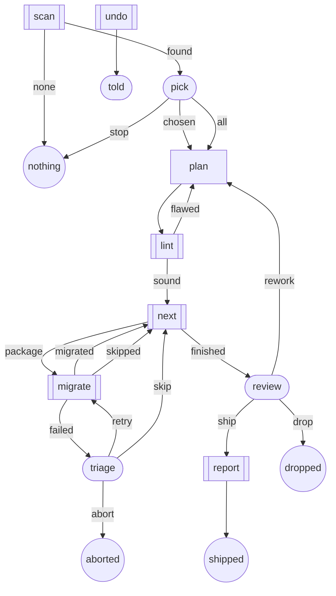

---
inputs:
  old: {type: string, required: true, description: "the deprecated function, as path/to/pkg.Name"}
  new: {type: string, required: true, description: "what replaces it, as path/to/pkg.Name"}
  base: {type: string, default: main, description: the branch the migration starts from}
  brief: {type: string, default: "", description: anything the migration should keep to}
outputs_by:
  shipped:
    summary: ${{ steps.report.outputs.summary }}
    migrated: ${{ steps.next.outputs.done }}
  dropped:
    why: ${{ steps.review.outputs.why }}
  aborted:
    reason: ${{ steps.migrate.outputs.reason }}
  nothing:
    sites: ${{ optional(steps.scan.outputs.count) }}
documents:
  plan: {from: templates/plan.md}
  brief: {input: brief}
  log:
exclude_tools: [web_fetch]
timeout: 20m
on_abort: undo
max_steps: 150
---
# Migrate an API



## scan
```yaml
description: Finds every call of the old function, by package.
run: scripts/scan.sh
with:
  old: ${{ inputs.old }}
  base: ${{ inputs.base }}
outcomes: [found, none]
outputs:
  found:
    packages: {type: array, required: true, items: {type: string}}
    count: {type: integer, required: true}
    sites:
      type: array
      required: true
      items:
        type: object
        properties:
          file: {type: string, required: true}
          line: {type: integer, required: true}
    report: {type: string, required: true}
show: [packages, count]
documents:
  write: {log: report}
```

## pick
```yaml
with:
  count: ${{ steps.scan.outputs.count }}
  packages: ${{ steps.scan.outputs.packages }}
outcomes: [chosen, all, stop]
choices:
  from: ${{ steps.scan.outputs.packages }}
  select: many
  outcome: chosen
  as: packages
text: {outcome: stop, as: why}
unattended: all
timeout: 2h
on_timeout: all
```
The old function is called ${{ steps.scan.outputs.count }} times. Which
packages should this migration cover: some, all of them, or none?

## plan
```yaml
description: Orders the packages so that each one builds once those before it are done.
context: fresh
child: planner
thinking: high
instructions: prompts/planner.md
files: [./reference/style.md]
tools: [read, grep]
with:
  old: ${{ inputs.old }}
  new: ${{ inputs.new }}
  packages: ${{ latest(steps.pick.outputs.packages, steps.scan.outputs.packages) }}
  errors: ${{ optional(steps.lint.outputs.errors) }}
  notes: ${{ optional(steps.review.outputs.notes) }}
documents:
  read: [brief]
  edit: [plan]
outputs:
  ok:
    order: {type: array, required: true, items: {type: string}}
    risk: {type: string, required: true, enum: [low, high]}
max_visits: 6
```
Plan the migration. Order the packages so that each one still builds
once those before it are migrated: a package before the packages that
import it. Write the plan into the plan document, keeping its headings.

data.order is every package you were given, in that order, and nothing
else. data.risk is high when a package's tests do not cover the calls
you will change.

## lint
```yaml
run: scripts/lint.sh
with:
  order: ${{ steps.plan.outputs.order }}
  packages: ${{ latest(steps.pick.outputs.packages, steps.scan.outputs.packages) }}
outcomes: [sound, flawed]
outputs:
  flawed:
    errors: {type: array, required: true, items: {type: string}}
max_visits: 6
```

## next
```yaml
description: Hands out the next package of the plan, or says the plan is done.
run: scripts/next.sh
with:
  order: ${{ steps.plan.outputs.order }}
  done: ${{ optional(steps.next.outputs.done) }}
outcomes: [package, finished]
outputs:
  package:
    package: {type: string, required: true}
    done: {type: array, required: true, items: {type: string}}
  finished:
    done: {type: array, required: true, items: {type: string}}
max_visits: 20
```

## migrate
```yaml
flow: ./flows/package.md
context: fresh
dir: ${{ steps.next.outputs.package }}
timeout: 30m
with:
  package: ${{ steps.next.outputs.package }}
  old: ${{ inputs.old }}
  new: ${{ inputs.new }}
policy:
  deny:
    - {rule: "bash(git push:*)", note: nothing is published before the review}
max_visits: 20
```

## triage
```yaml
with:
  package: ${{ steps.next.outputs.package }}
  reason: ${{ steps.migrate.outputs.reason }}
outcomes: [retry, skip, abort]
unattended: skip
max_visits: 10
judge:
  outcomes: [retry, skip]
  tools: [read]
  max_returns: 1
  criteria: |
    Retry when the reason is a flake or a timeout. Skip when the package
    cannot build without a change outside it. Hand back anything else.
```
Migrating this package failed. Try it again, skip it and go on, or stop
the migration?

## review
```yaml
with:
  migrated: ${{ steps.next.outputs.done }}
  plan: ${{ documents.plan }}
  log: ${{ documents.log }}
outcomes: [ship, rework, drop]
outputs:
  drop:
    why: {type: string, required: true}
text: {outcome: rework, as: notes}
max_visits: person
```
Every package in the plan has been worked on. Ship the change, send the
plan back with notes, or drop it?

## report
```yaml
run: scripts/report.sh
with:
  base: ${{ inputs.base }}
  migrated: ${{ steps.next.outputs.done }}
outputs:
  ok:
    summary: {type: string, required: true}
documents:
  write: {log: summary}
```

## undo
```yaml
run: scripts/undo.sh
with:
  base: ${{ inputs.base }}
  done: ${{ optional(steps.next.outputs.done) }}
```

## told
```yaml
with:
  done: ${{ optional(steps.next.outputs.done) }}
outcomes: [ok]
unattended: ok
```
The migration was abandoned and its changes were set aside on a branch.
Noted?
