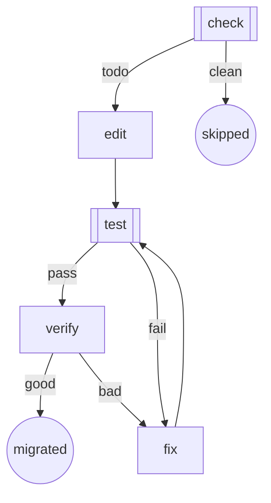

# Migrate one package



## check
```yaml
run: scripts/check.sh
with:
  old: ${{ inputs.old }}
outcomes: [todo, clean]
outputs:
  clean:
    why: {type: string, required: true}
```

## edit
```yaml
tools: [read, grep, edit]
with:
  package: ${{ inputs.package }}
  old: ${{ inputs.old }}
  new: ${{ inputs.new }}
policy:
  deny:
    - {rule: "edit(*_test.go)", note: the tests are what the change is held to}
outputs:
  ok:
    summary: {type: string, required: true}
```
Replace every call of the old function in this package with the new
one. Change nothing else. data.summary says in one sentence what you
changed.

## test
```yaml
run: scripts/test.sh
outcomes: [pass, fail]
outputs:
  fail:
    failures: {type: array, required: true, items: {type: string}}
    log: {type: string, required: true}
show: [failures]
max_visits: 4
```

## fix
```yaml
tools: [read, grep, edit]
with:
  failures: ${{ optional(steps.test.outputs.failures) }}
  problems: ${{ optional(steps.verify.outputs.problems) }}
policy:
  deny:
    - {rule: "edit(*_test.go)", note: the tests are what the change is held to}
outputs:
  ok:
    summary: {type: string, required: true}
max_visits: 4
```
Fix what the tests or the reviewer found, and nothing else. data.summary
says in one sentence what the package's change now is.

## verify
```yaml
context: fresh
child: reviewer
tools: [read, grep]
with:
  old: ${{ inputs.old }}
  new: ${{ inputs.new }}
  package: ${{ inputs.package }}
outcomes: [good, bad]
outputs:
  bad:
    problems: {type: array, required: true, items: {type: string}}
max_visits: 4
```
Read this package's diff against its base. It should replace calls of
the old function with the new one and do nothing else. Report anything
else it does as a problem.
