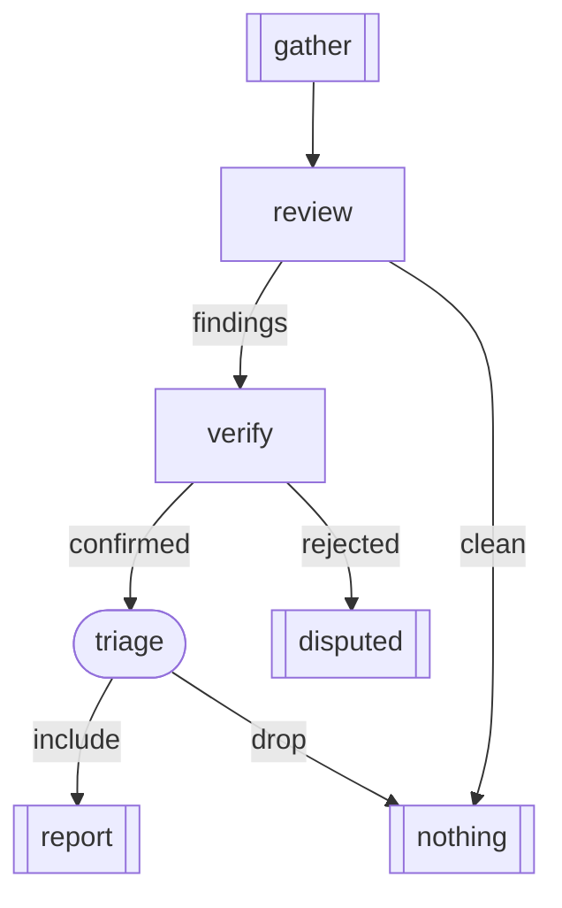

---
inputs:
  repo: {type: string, required: true}
  pr: {type: integer, required: true}
outputs:
  summary: ${{ steps.review.outputs.summary }}
---
# PR review



## gather
```yaml
run: scripts/gather.sh
with:
  repo: ${{ inputs.repo }}
  pr: ${{ inputs.pr }}
```

## review
```yaml
with:
  title: ${{ steps.gather.outputs.title }}
  description: ${{ steps.gather.outputs.body }}
  diff: ${{ steps.gather.outputs.diff }}
tools: [read, grep]
outcomes: [clean, findings]
outputs:
  clean:
    summary: {type: string, required: true}
  findings:
    summary: {type: string, required: true}
    findings:
      type: array
      required: true
      items:
        type: object
        properties:
          file: {type: string, required: true}
          problem: {type: string, required: true}
```
Review this pull request. The repository is checked out at the pull
request's head; use read and grep to see code around the diff.

Report only real problems: a bug in the changed code, or something the
description claims that the diff does not do. Style is not a problem.
data.summary says in two sentences what the change does.

## verify
```yaml
with:
  findings: ${{ steps.review.outputs.findings }}
tools: [read, grep]
outcomes: [confirmed, rejected]
outputs:
  rejected:
    reasons:
      type: array
      required: true
      items:
        type: object
        properties:
          file: {type: string, required: true}
          why: {type: string, required: true}
          evidence: {type: string, required: true}
  confirmed:
    findings:
      type: array
      required: true
      items:
        type: object
        properties:
          file: {type: string, required: true}
          problem: {type: string, required: true}
          evidence: {type: string, required: true}
```
Try to disprove each finding by reading the code it names. Keep a finding
only if the code shows it, and quote that code as its evidence. If none
survives, the outcome is rejected, and data.reasons says for each why,
quoting the code that disproves it.

## disputed
```yaml
run: scripts/disputed.sh
with:
  title: ${{ steps.gather.outputs.title }}
  summary: ${{ steps.review.outputs.summary }}
  findings: ${{ steps.review.outputs.findings }}
  reasons: ${{ steps.verify.outputs.reasons }}
```
A dismissed finding is still reported, with why: whoever reads the
report decides, and nothing disappears on one model's say-so.

## nothing
```yaml
run: scripts/nothing.sh
with:
  title: ${{ steps.gather.outputs.title }}
  summary: ${{ steps.review.outputs.summary }}
```

## triage
```yaml
with:
  findings: ${{ steps.verify.outputs.findings }}
outcomes: [include, drop]
unattended: include
```
These findings were confirmed. Include them in the report?

## report
```yaml
run: scripts/report.sh
with:
  title: ${{ steps.gather.outputs.title }}
  summary: ${{ steps.review.outputs.summary }}
  findings: ${{ steps.verify.outputs.findings }}
```
