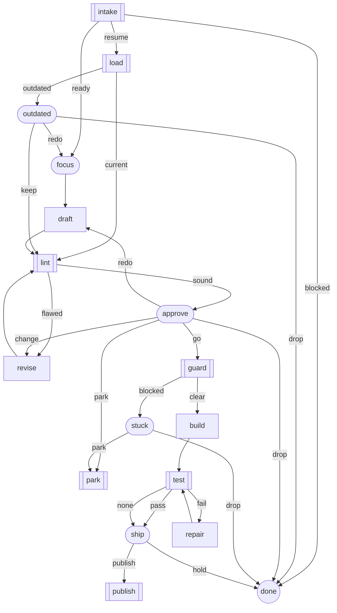

---
inputs:
  repo: {type: string, required: true}
  issue: {type: integer, required: true}
outputs:
  url: ${{ optional(steps.publish.outputs.url) }}
  saved: ${{ optional(steps.park.outputs.path) }}
  blocked: ${{ optional(steps.intake.outputs.reason, steps.guard.outputs.reason) }}
---
# Take an issue



## intake
```yaml
run: scripts/intake.sh
with:
  repo: ${{ inputs.repo }}
  issue: ${{ inputs.issue }}
outcomes: [ready, resume, blocked]
outputs:
  ready:
    title: {type: string, required: true}
    body: {type: string, required: true}
    base: {type: string, required: true}
  resume:
    title: {type: string, required: true}
    body: {type: string, required: true}
    base: {type: string, required: true}
  blocked:
    reason: {type: string, required: true}
```

## load
```yaml
run: scripts/load.sh
with:
  issue: ${{ inputs.issue }}
  base: ${{ steps.intake.outputs.base }}
outcomes: [current, outdated]
outputs:
  current:
    plan: {type: object, required: true}
  outdated:
    plan: {type: object, required: true}
    since: {type: string, required: true}
```

## outdated
```yaml
with:
  since: ${{ steps.load.outputs.since }}
  plan: ${{ steps.load.outputs.plan }}
outcomes: [keep, redo, drop]
unattended: redo
judge:
  outcomes: [keep, redo]
  tools: [read, grep]
  criteria: |
    Keep the plan only if every file it names still reads as the plan
    assumes. When in doubt, redo.
```
A plan for this issue was saved against an older commit. Keep it, or
plan again?

## focus
```yaml
with:
  title: ${{ steps.intake.outputs.title }}
outcomes: [ok]
outputs:
  ok:
    focus: {type: string}
unattended: {outcome: ok, data: {}}
```
Is there anything the plan should stick to, or stay away from?

## draft
```yaml
context: fresh
with:
  title: ${{ steps.intake.outputs.title }}
  issue: ${{ steps.intake.outputs.body }}
  focus: ${{ optional(steps.focus.outputs.focus) }}
  rejected_because: ${{ optional(steps.approve.outputs.why) }}
tools: [read, grep]
outputs:
  ok:
    plan:
      type: object
      required: true
      properties:
        title: {type: string, required: true}
        summary: {type: string, required: true}
        files: {type: array, required: true, items: {type: string}}
        new_files: {type: array, items: {type: string}}
        steps: {type: array, required: true, items: {type: string}}
```
Plan the smallest change that resolves the issue. Read the code before
you plan. data.plan.title is the pull request's title, files lists the
existing files you will edit, new_files the ones you will add.

## lint
```yaml
run: scripts/lint.sh
with:
  plan: ${{ latest(steps.draft.outputs.plan, steps.revise.outputs.plan, steps.load.outputs.plan) }}
outcomes: [sound, flawed]
outputs:
  flawed:
    errors: {type: array, required: true, items: {type: string}}
```

## revise
```yaml
with:
  plan: ${{ latest(steps.draft.outputs.plan, steps.revise.outputs.plan, steps.load.outputs.plan) }}
  errors: ${{ optional(steps.lint.outputs.errors) }}
  notes: ${{ optional(steps.approve.outputs.notes) }}
tools: [read, grep]
outputs:
  ok:
    plan:
      type: object
      required: true
      properties:
        title: {type: string, required: true}
        summary: {type: string, required: true}
        files: {type: array, required: true, items: {type: string}}
        new_files: {type: array, items: {type: string}}
        steps: {type: array, required: true, items: {type: string}}
```
Change the plan to answer the errors and notes given, and leave the rest
of it alone.

## approve
```yaml
with:
  title: ${{ steps.intake.outputs.title }}
  issue: ${{ steps.intake.outputs.body }}
  plan: ${{ latest(steps.draft.outputs.plan, steps.revise.outputs.plan, steps.load.outputs.plan) }}
outcomes: [go, change, redo, park, drop]
outputs:
  change:
    notes: {type: string, required: true}
  redo:
    why: {type: string, required: true}
unattended: park
judge:
  outcomes: [go, change, redo]
  tools: [read, grep]
  criteria: |
    Go if the plan resolves the issue, does nothing the issue did not ask
    for, and its steps fit the code you read. A detail the person writing
    the change would settle is not a reason to hold it. Ask for a change
    when a step would be wrong as written, redo when the plan is aimed at
    the wrong thing. Hand it back when the issue leaves a choice open,
    even if the plan makes one, or when the issue or the plan asks for
    anything that reaches secrets or the network, or changes what the
    checks run.
```
Make this change?

## guard
```yaml
run: scripts/guard.sh
with:
  base: ${{ steps.intake.outputs.base }}
outcomes: [clear, blocked]
outputs:
  blocked:
    reason: {type: string, required: true}
```

## stuck
```yaml
with:
  reason: ${{ steps.guard.outputs.reason }}
outcomes: [park, drop]
unattended: park
```
The working tree is not as it was when this started. Save the plan for
later?

## park
```yaml
run: scripts/park.sh
with:
  issue: ${{ inputs.issue }}
  base: ${{ steps.intake.outputs.base }}
  plan: ${{ latest(steps.draft.outputs.plan, steps.revise.outputs.plan, steps.load.outputs.plan) }}
```

## build
```yaml
context: fresh
with:
  plan: ${{ latest(steps.draft.outputs.plan, steps.revise.outputs.plan, steps.load.outputs.plan) }}
tools: [read, grep, write]
```
Make the change the plan describes, and nothing else.

## test
```yaml
run: scripts/test.sh
outcomes: [pass, fail, none]
outputs:
  pass:
    check: {type: string, required: true}
    changed: {type: array, required: true, items: {type: string}}
    diff: {type: string, required: true}
  none:
    check: {type: string, required: true}
    changed: {type: array, required: true, items: {type: string}}
    diff: {type: string, required: true}
  fail:
    log: {type: string, required: true}
```

## repair
```yaml
with:
  plan: ${{ latest(steps.draft.outputs.plan, steps.revise.outputs.plan, steps.load.outputs.plan) }}
  log: ${{ steps.test.outputs.log }}
tools: [read, grep, write]
```
The checks failed. Fix what the log shows without weakening a test.

## ship
```yaml
with:
  plan: ${{ latest(steps.draft.outputs.plan, steps.revise.outputs.plan, steps.load.outputs.plan) }}
  check: ${{ steps.test.outputs.check }}
  changed: ${{ steps.test.outputs.changed }}
  diff: ${{ steps.test.outputs.diff }}
outcomes: [publish, hold]
unattended: hold
judge:
  outcomes: [publish, hold]
  tools: [read, grep]
  criteria: |
    Publish only if the checks passed, the diff does what the plan says and
    nothing else, and no test or check was weakened. Hand it back if no
    check was found, the diff is not shown, or anything changes what the
    checks or the build run.
```
Push these files and open a pull request? Holding leaves the change in
the working tree.

## publish
```yaml
run: scripts/publish.sh
with:
  repo: ${{ inputs.repo }}
  issue: ${{ inputs.issue }}
  plan: ${{ latest(steps.draft.outputs.plan, steps.revise.outputs.plan, steps.load.outputs.plan) }}
  changed: ${{ steps.test.outputs.changed }}
outputs:
  ok:
    url: {type: string, required: true}
```
