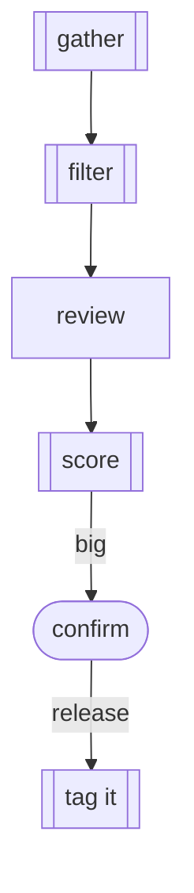

---
inputs:
  pr: {type: integer, required: true}
outputs:
  summary: ${{ steps.score.outputs.summary }}
---
# Release



## gather
```yaml
run: scripts/gather.sh
with:
  pr: ${{ inputs.pr }}
```
Stands in for `gh pr view --json files`.

## filter
```yaml
run: scripts/filter.sh
with:
  files: ${{ steps.gather.outputs.files }}
```

## review
```yaml
with:
  paths: ${{ steps.filter.outputs.paths }}
context: fresh
outputs:
  ok:
    summary: {type: string, required: true}
```
Summarise the change in one sentence, as data.summary.

### An example

```json
{"summary": "Adds a parser."}
```

## score
```yaml
run: scripts/score.sh
with:
  added: ${{ steps.filter.outputs.added }}
  summary: ${{ steps.review.outputs.summary }}
outcomes: [big, small]
outputs:
  big:
    summary: {type: string, required: true}
  small:
    summary: {type: string, required: true}
```

## confirm
```yaml
with:
  summary: ${{ steps.score.outputs.summary }}
outcomes: [release, abort]
outputs:
  release:
    version: {type: string, required: true}
```
Which version is this?

## tag
```yaml
tool: git_tag
args: {sign: true}
with:
  name: ${{ steps.confirm.outputs.version }}
```
